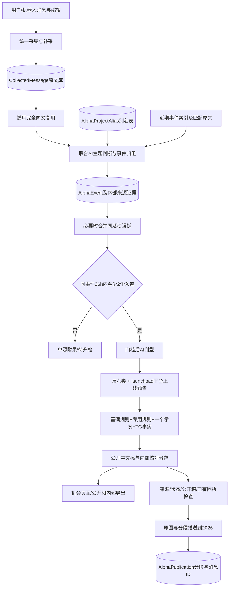
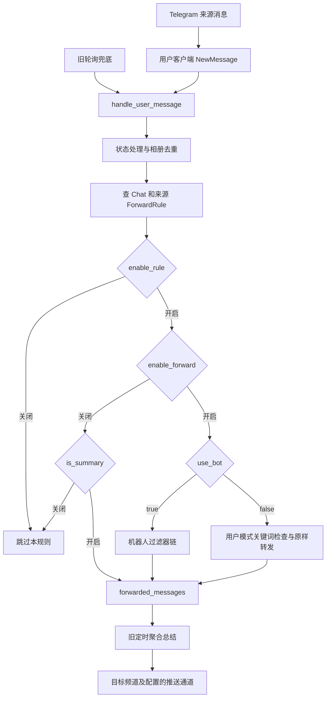

# TelegramForwarder 现有框架与链路梳理

最近更新：2026-11-14。本次新增 Launchpad 上线预告第七类，沿用现有统一采集和机会发布链路；当前结构、扩展接点和部署状态见下方“当前实现”。第1–9节保留为2026-11-07改造前历史快照，其中“尚未实现”“仅方案”和旧采集限制均不代表当前版本。

> 2026-11-25 更新前重新核对：最新代码与现场配置见 [P19｜当前架构与AI版块扩展检查](P19-当前架构与AI版块扩展检查-20261125.md)。下文2026-11-14内容保留历史参考；AI新增链路尚未接入生产，不应与既有Alpha链混读。

## 当前实现（2026-11-14）

### 运行与模块关系

- 主程序仍为 main.py，持有Telethon用户/机器人客户端；FastAPI提供Web API，React提供规则与机会页面。新机会链路复用同一套TG会话、SQLAlchemy和模型provider，不新建独立登录或模型管理。
- message_listener.py 的用户/机器人新消息入口及编辑入口接入 alpha.storage.collect_event。采集不依赖直转或旧总结开关；同来源、同消息唯一，编辑递增revision并使旧证据失效。相册逐条保存，不因旧直转相册去重丢后续原文。
- ForwardRule 的 enable_collect / enable_forward / is_summary 相互独立；已迁移来源由 is_migrated 等边界阻止旧 forwarded_messages 重复落库。旧直转和SummaryScheduler代码保留，本次不重开旧入口。
- alpha.scheduler.scheduler_loop 按北京时间07:00、13:00、19:00调用 alpha.pipeline.run_pipeline。CLI和定时复用同一执行函数和数据库级锁。主进程启动时加载新提示词，更新后需重启。



主题AI识别crypto/ipo/both/reject/uncertain；归组与主题同轮完成。代码校验JSON、按不同source_id/chat_id计来源；双TG覆盖不等于官方核验。36h按消息发布时间跨批次累计；同频道多帖不增加来源。没有关键词硬过滤，不能把其他转发链的关键词设置当成Alpha轻筛。

### 数据与接口

| 位置 | 当前职责 |
|---|---|
| CollectedMessage | 原文、entities隐藏链接、媒体元数据、回复/相册、发布时间、revision、分析与usage状态 |
| AlphaEvent | 项目/事件/阶段、sources证据、content_type、editorial判型、中文草稿与内部说明、截止和处理状态 |
| AlphaProjectAlias | 有证据的别名归一；不能拿别名合并不同事件或凑来源 |
| AlphaCollectionState | 启用来源与补采进度 |
| AlphaJob | 调度/发布开关、目标、模型、last_slot与最近结果 |
| AlphaPublication | 每目标每事件的发送状态、正文指纹、各分段消息ID、失败与未知结果 |
| rss/app/routes/alpha.py | /api/alpha/status、config、run、export；公网前缀为/tg/api/alpha |
| frontend/src/pages/AlphaPage.tsx | 机会主清单、单源附录、历史/结束状态、文案类型、草稿与下载 |

机会页“立即筛选并推送”受publish_enabled配置影响，不能当纯预览按钮。CLI python -m alpha run 不提供TG客户端，实际不会发送；此命令仍会分析并保存业务状态。离线纯模型试稿须独立于生产库运行，不能把CLI落库说成只读。

### 本次新增：Launchpad即将上线

沿用原扩展点，新增 content_type=launchpad，不增加表结构、采集器、调度器或发布器。

| 环节 | 新增行为 |
|---|---|
| 过滤 | 不限链、不限语言；平台对象与发行用途明确，且有具体上线窗口、测试/早期准入或开发里程碑才形成平台预告 |
| 排除 | 纯生态名单、RPC/域名清单、历史复盘、行情份额不能当新平台上线；只有链接/图片而不明时uncertain |
| 归组 | 平台自身上线、平台卖币、平台内项目发行、已上线奖励活动分开；不能只按项目名凑双来源 |
| 判型 | 平台上线/测试/准入预告走launchpad；平台币/平台内发行走sale；已开放多步活动走tutorial；后续独立延期/取消走update |
| 时间 | 结合消息时间和任务now判断；旧日期预告不再标preview，不推断已经上线，不拿开始日期当活动截止 |
| 成稿 | 项目介绍→开放安排→实际条件→官方入口；项目名称、时间、官方社交在TG已确认时必须保留 |
| 缺失 | 核心字段缺失写context_gaps/internal_notes，不猜账号/网址，不把资料缺失写成官方未公布；本次未新增缺一项便拒发的门槛 |
| 事实边界 | X和示例只指导排版；当前事实来自TG原文和明确同事件证据，不假装读了附链网页 |
| 推送 | 保持36h双源、07/13/19、目标2026、现有原图/分段/回执。单源内部留存，sent不重发 |

官方社交可为原文明确的官方X主页/公告或官方TG入口，不能用采集频道/KOL回链代替；官网与参与入口分别标注。关键费用、退款、资格等真实规则保留，内部翻译和核对过程不进入公开稿。

### 后续新增版块怎么接

1. alpha/prompts.py：扩ANALYZE范围与事件边界；升级ANALYSIS_VERSION。仅增加模板不能使此前被拒绝主题进入事件库。
2. alpha/editorial.py：在TYPES、TYPE_PROMPT、RULES、EXAMPLES注册类型、选型条件、专用提示词和一个配对示例；升级TYPE_VERSION。示例必须与输入依据配对，不能作为新事件事实。
3. frontend/src/pages/AlphaPage.tsx：补contentTypes中文名称。API/数据库content_type为通用字符串，发布器读取TYPES，不需为每类建新表或分支发送器。
4. tests/test_alpha.py：验证新路由、原路由不串示例、单源升双源、快照/导出和发布回执；小样本真实AI确认语义边界，不能只mock分类后宣称AI识别准确。
5. 部署前核对线上实际差异、必要备份、隔离回归；在服务器现有前端源码上构建，保留其他线上修改；重启后核对服务版本、客户端连接与任务配置。

当前版本：ANALYSIS_VERSION=alpha-joint-v3-launchpad；TYPE_VERSION=editorial-type-v2-launchpad。COPY_VERSION=six-types-v3是共用正文规则的历史版本号，不是当前类型数量。基础DRAFT_VERSION=draft-public-v3。

版本更新不会自动将既有reject置pending，也不会全史重跑1,890条；新入站按新主题处理，近期合格事件按新判型版本复核。已有sent回执阻止重发。需要补判旧拒绝消息时，仅对36h内相关候选定向预览，不能无差别重置历史状态。

### 已知边界

- 新主题的识别、事件语义和日期理解依赖模型；代码强制校验结构与来源数，不保证所有语义误判都被拦截。仅元数据图片不等于OCR或完整图片理解。
- 消息编辑会使库内证据/草稿失效，但已发TG消息不自动撤回或更正；sent事件后续不会自动重发。closed进展的自动发布仍未开放。
- 本次不改原六类业务口径，不改来源门槛或原有定时；旧业务故障与历史文档结论须按当前代码/运行证据判断。

### 本次检查与部署

- [x] 本地七类路由、双来源与推送回执隔离回归通过；真实模型小样本完成。历史原文与虚构夹具分开标注。
- [x] 服务器部署、实际加载版本、客户端健康和前端资源核验：通过。北京时间2026-11-14 01:50完成确认。
- [ ] 自然定时遇到合格新平台预告后的真实频道发送：未执行，不将隔离回执冒充真实发送。

部署记录：运行目录 `/opt/TelegramForwarder`，服务 `telegram-forwarder.service`，本次主PID 2125930，Web子进程2126024；主程序唯一实例，user/bot均connected。服务器隔离回归50项通过、服务器现有源码前端构建通过；实际加载资源 `/tg/assets/index-ezOJ1NMB.js` 返回200并包含新增中文类型。文件指纹与已检查版本一致。

定时/发布开关均true，模型gpt-6.1-sol，目标-1003905915992（2026），采集启用57来源；旧SummaryScheduler启动时找到0条启用总结规则。未手动触发生产整轮或另发机会测试帖，原sent记录仍27；最近一轮partial及5个旧blocked来自更新前任务，不冒充本次运行结果，也未借此放宽规则。

重启初始化原有57频道轮询约需几十秒；第一次就绪检查过早超时，API短暂502，随后TG健康200、Web子进程启动完成，公网代理下API对未登录请求恢复401。401只证明鉴权入口可用，未做本轮浏览器登录态交互或新平台自然发送验收。

回滚材料：`/var/backups/tgbot-p12-20261114/launchpad-174750`，含original文件、原dist、配置只读快照、部署manifest及activation核验记录。此次无新增字段/数据库迁移，不需回退业务数据。若回滚，先停服务，恢复original内本次运行文件及原dist/index.html，再启动；旧静态资源保留，历史发送记录不清除。不要整体覆盖其他线上源码或重置配置。

## 2026-11-24 新订阅频道同步

用户新增订阅频道“滚雪球” `@xueqiu2026`（`-1004371662304`），要求原“2026”内容再同步一份。已核对BOT在两个频道均有管理员权限，新频道允许发帖；用户客户端未加入新频道，因此由既有bot_client发送。

- `alpha/mirror.py`读取AlphaPublication中主频道确认sent的记录，按实际发送的各parts.message_id，通过Telegram ForwardMessagesRequest(drop_author=True)复制到新频道。保留图片、文字entities和链接，不添加转发来源署名；不再次筛选、不调用AI、不改变原文采集及36h门槛。
- `main.py`创建mirror_loop(bot_client, user_client)，每30秒检查新增发送记录；退出时取消同步任务。原07/13/19机会任务和主频道保持原方式运行。
- 每事件每目标复用AlphaPublication唯一约束，独立保存同步分段、random_id、消息ID与失败状态；主频道成功记录不会被同步失败覆盖。未确认发送结果使用既有用户客户端读取目标公开频道历史（BOT不能调用GetHistory），不能确认时保留unknown，不盲目重发。
- `.env`配置 `ALPHA_MIRROR_TARGET=@xueqiu2026` 和带UTC时区的 `ALPHA_MIRROR_SINCE`，只同步启用时间之后新发布的内容；不批量补发历史。发布总开关关闭时同步也暂停。该同步仅覆盖Alpha有成功回执的机会内容，不是主频道人工消息的通用搬运规则。
- 用户要求的同步配置已授权。先复制主频道最新一条作为真实验收，其他历史不补发。同步目标配置暂由服务器环境变量维护，网页不新增控制项；更改需重启主服务。
- 本地与服务器52项机会回归通过，含同步去重、时间范围、发布开关、分段复制与unknown回执核对；修正BOT无法读取历史的限制后，服务器两项受影响同步回归通过。
- 已部署至 `/opt/TelegramForwarder`，备份 `/var/backups/tgbot-mirror-20261124/030112`。启用边界为北京时间2026-11-24 11:03:54，仅新发布记录进入常规同步。
- 真实验收：主频道event571、message42120（Acepyr，含图片）已复制到新频道message2：https://t.me/xueqiu2026/2 。逐项读取源/目标确认正文、entities及图片ID一致，无转发署名；再次执行sent=0。主频道原记录未改。已在Chat表登记新频道，未新增来源采集规则。
- 重启时旧Web后台连接导致停服超过45秒，systemd随后结束旧进程。一次清理命令与新实例启动交错造成额外重启，服务自动恢复；不借本次任务调整全局停服策略。
- 最终核验：主PID2405188、Web子进程2405377，user/bot连接健康，API正常返回鉴权401；运行文件指纹一致，启动日志无同步异常。
- 回滚：停止主服务，恢复备份original/main.py及.env后启动，保留同步模块和已有发送回执即可，避免重复补发。取消同步也可清空ALPHA_MIRROR_TARGET并重启；不删除主频道或订阅频道消息。

## 历史快照：2026-11-07改造前

## 1. 框架组成和进程关系

| 部分 | 实现 | 实际职责 |
|---|---|---|
| 主程序 | `main.py`，Python / asyncio | 持有 Telegram 客户端、消息监听、轮询、旧总结调度、聊天信息更新和内部桥接 |
| Telegram 接入 | Telethon；用户账号客户端与机器人客户端 | 用户客户端接收来源消息，也可原样转发；机器人客户端处理命令 / 回调，以及机器人模式发送和总结推送 |
| 数据层 | SQLAlchemy，`models/models.py` | 数据库由 `DATABASE_URL` 决定；启动时 `create_all` 再执行现有追加迁移；当前表结构以转发规则为中心 |
| Web API | FastAPI，`rss/main.py`、`rss/app/routes/console.py` | 登录、规则、Chat、AI 沙盒、总结历史、RSS 等；主程序可经 `rss_runner.py` 在独立子进程启动 |
| 网页 | React / TypeScript，`frontend/src` | 规则设置、TG 管理、RSS 管理、AI 沙盒、运维监控；生产 API 前缀在源码中是 `/tg/api`，实际代理部署本次未现场核验 |
| 内部桥接 | `main.py:start_internal_server`，aiohttp，默认本机 8001 | Web 进程请求主进程解析 Telegram 实体、查询客户端连接、触发旧总结；不是外部网站业务端口 |
| AI 接入 | `ai/` provider + `utils/settings.py` 模型配置 | 由 `get_ai_provider` 选择供应商；实时 AI、旧总结、沙盒共用 provider 层，但业务流程不同 |
| 历史机会实验 | `scratch/alpha_10d_*.py`、`alpha_semantic_dedup.py` 等 | 离线拉取、分类、去重和文档生成；尚未成为在线监听 / Web / 定时业务链路 |

数据库是 Web 配置与主程序之间的共同存储，内部桥接用于必须在主进程 Telegram 会话中执行的操作。Web API 保存数据库并不天然意味着主进程已重建内存调度。

## 2. 启动顺序

`main.py` 初始化数据库和两个 Telethon 客户端 → `start_clients` 连接客户端 → 获取对话并对现有启用来源规则做接入准备 → 注册监听 → 启动轮询兜底 → 注册机器人命令 → 启动 `SummaryScheduler` → 启动 ChatUpdater → 启动内部桥接 → 按配置启动 Web 子进程 → 进入客户端运行循环。

源码另有无 update 超过约五分钟就断开用户客户端的 watchdog，并依赖外部服务管理重启恢复；本次未核实服务器服务管理配置。它监测收到 update 的时间，不证明所有配置来源均被完整采集。

## 3. 消息入口与规则分支



`message_listener.py` 先查来源 Chat 和该 Chat 的转发规则。找不到来源规则就不走业务处理；已加入 Telegram、网站有 Chat、属于 ALPHA 文件夹是不同事实，不能替代启用规则。

`enable_forward=false && is_summary=true` 是目前的特殊“只落库”入口，但这不等于独立采集，因为同一 `is_summary` 还负责让旧总结调度器选中规则。

相册去重用内存 `PROCESSED_GROUPS` 在规则处理前跳过同组后续事件。它服务当前相册整体转发，不适合直接充当逐条原始消息采集机制。当前监听注册只有 `NewMessage`，未见 `MessageEdited` 接入。

## 4. 实时直转实际有两套实现

### 机器人模式：完整过滤器链

代码：`filters/process.py`、`filters/filter_chain.py`。

```text
初始化 → 延迟 → 关键词 → 文本替换 → 媒体处理
→ AIFilter → 来源/时间等信息 → 评论按钮 → RSS
→ 原消息编辑 → SenderFilter 发送 → MessageLogFilter 落库
→ 回复处理 → 外部推送 → 按规则删除原消息
```

过滤器返回 false 或抛错会中断其后步骤。`is_ai` 控制实时 AIFilter，它处理当前消息，可按配置加载图片、改写文本，之后还可再检查关键词。它不执行跨来源事件归组或共同推送门槛。

注意：AIFilter 对部分 AI 错误会记录后继续；当前 OpenAI provider 还可能把异常转换成非空的“AI处理失败”字符串返回。因此“得到字符串”不等于 AI 成功。新流程不能直接沿用这一成功判定。

### 用户模式：另一条简化路径

代码：`handlers/user_handler.py`。

主要是关键词检查 → 通过用户客户端 `forward_messages` 原样转发 → 调用落库工具；相册会查询附近消息后整组转发。该路径没有调用上述完整过滤器链，不能默认认为机器人模式的实时 AI、替换和其他过滤设置在用户模式中同样执行。

`use_bot` 因此会影响业务路径，不只是更换发送身份。

## 5. 数据库目前保存什么

| 表 / 模型 | 内容 | 与新目标相关的边界 |
|---|---|---|
| `chats` / Chat | Telegram ID、名称等来源或目标记录 | 是网站资料，不是采集订阅和实际加入状态的完整映射 |
| `forward_rules` / ForwardRule | 来源与目标，以及关键词、实时 AI、总结和转发配置 | 绑定来源与目标；同源同目标唯一；采集尚无独立开关 |
| `forwarded_messages` / ForwardedMessage | 按规则与目标保存的源消息正文、源消息 ID、原始时间、媒体布尔值、是否总结 | 既承接已转发消息，也承接关闭直转后待总结的原文；不代表完整原始消息库 |
| `summary_history` / SummaryHistory | 聚合总结正文、时间窗口、模型、Prompt 和统计 | 归档的是主总结；不能据此认为另外两份写作推送也有同等独立归档和发送状态 |
| Keyword / ReplaceRule / PushConfig / RSSConfig 等 | 各规则附属配置 | 复用价值存在，但各有原业务副作用 |

`utils/message_logger.py` 保存 `event.message.text`，不是实时 AI 改写后的内容。当前未保存完整 entities / 隐藏链接映射、相册与回复关联，也没有按“来源 Telegram ID + 源消息 ID”的唯一约束。

旧原文记录与规则有级联删除关系，规则删除可删除对应落库消息；落库失败只记日志，不让转发失败。它适合作为原转发业务的附属记录，不能直接保证新流程需要的唯一原文、可靠续接和长期事件证据。

`MessageLogFilter` 在 SenderFilter 后，但 SenderFilter 的“仅外部推送”分支可跳过 TG 发送并返回 true，所以到达落库过滤器也不总能证明已成功发送到 Telegram。

## 6. 旧三个 AI 输出的真实关系

代码：`scheduler/summary_scheduler.py`。

```text
查 is_summary=true 的规则
→ 按目标频道合并调度时间
→ 为每个目标频道建立内存 asyncio 任务
→ 查询该目标下未总结且在计算时间窗口内的 forwarded_messages
→ 拼接源名称、时间与正文；过长保留尾部
→ 主总结 AI → 写 SummaryHistory → 发送 / 可置顶 / 可外部推送
→ 同一批输入再跑“推文工厂” → 自动发送
→ 同一批输入再跑“信息差快报” → 自动发送
→ 把本次查询到的消息统一标为已总结 → 清理超期记录
```

这不是三个完全独立、可各自选输入和处理状态的任务；它们是同一目标聚合流程里的三个输出步骤。后两份 Prompt 即使规则未填写，也会回退到默认 Prompt，因此仅清空文本并不等于关闭它们。

几个明确影响改造的事实：

1. 查询原文时按 `target_chat_id` 筛选，没有进一步把输入限定为当前 `is_summary=true` 规则的记录。因而同一目标下其他规则写入的原文，也可能被该目标的总结选入。
2. 旧总结选择规则主要看 `is_summary`，不能认为仅关闭 `enable_forward` 或其他规则总开关就必然取消已注册的聚合任务。
3. `start` 合并同目标规则的时间，模型与 Prompt 使用建立目标配置时取到的参考规则值，并不是各来源规则各自独立使用其 Prompt。
4. `_get_last_run_time` 按当前时刻反算最近调度点；任务在调度点稍后执行时，可能以本次调度点作为查询起点，不能充当可靠的已完成进度。
5. 截断只保留部分正文，但最后按原查询集合标记完成；部分写作步骤异常也不会保证对应输入留待重试。
6. 已总结原文默认保留天数由配置决定，源码默认 7 天；还有未总结超过 30 天的清理路径。旧表不能视为无限期历史库。

这些是代码结构及可导致失败的路径，本次未在生产复现其实际发生次数。

## 7. 轮询、Web 配置和沙盒如何接入

**轮询**：`main.py:start_message_poller` 以启用规则的来源列表为基础，主要补不在 Telethon MessageBox 中的来源。首次启动从最新 ID 初始化；进度在内存中；每轮最多抓 10 条后推进到最新 ID。它服务实时转发兜底，不能证明断线或重启期间的历史缺口补齐。新增来源的轮询列表也不是实时从数据库刷新。

**Web 配置**：React → `/tg/api` → FastAPI → SQLAlchemy 写规则；TG 管理增删网站 Chat 不等于加入 / 退出 Telegram。部分实际 Telegram 操作经本机桥接交给主程序。

**配置生效**：来源规则通常在处理消息时重新查询；旧总结则在启动 / 特定回调时建内存任务。网页 `update_rule` 当前只保存数据库，未见重建旧调度器的调用；Telegram 某些时间设置回调则显式调用 `schedule_rule`。因此网页保存了新时间，不宜直接认定运行中的定时任务已经刷新。

**手动总结**：网站“立即总结” → Web API → bridge `/trigger-summary` → 主进程 `execute_all_summaries`。它执行有外部发送的旧业务流程，不是安全的本地预览入口。

**AI 沙盒**：从旧落库表聚合历史或使用提交的文本 → provider → 返回结果；运行测试本身不等于自动定时处理，应用 Prompt 则会写规则配置。机会实验脚本与沙盒都没有建立新的在线事件处理状态。

## 8. 哪些可以复用，哪些必须建立边界

可复用：现有 Telegram 客户端和会话、SQLAlchemy 及迁移方式、Web 登录 / API / React 页面框架、模型配置与 provider 路由、旧实验原文与提示词经验。

需要建立的边界：原文采集不能以是否发送 / 是否旧总结为条件；新机会事件不能直接使用目标频道聚合窗口；原文与内部来源证据不能因规则删除消失；公开中文稿不能携带采集来源署名；AI 失败必须区别于成功文本；原文处理、事件归组、草稿生成和最终发送不能共用一个 `is_summarized` 标志。

新增模块和表的最终数量要基于这些职责决定，不先假定四张或五张表就是答案。当前框架已有双客户端、API 与内部桥接，无需为此另起 Telegram 登录、凭据系统或第二套模型管理。

## 9. 当前结论

现有系统的主干是“以目标频道为中心的规则转发＋事后聚合写作”；新需求需要“以原始消息和事件为中心的机会处理”。两者可以共享基础设施，但采集条件、数据身份、任务状态和发送出口必须区分。

先以这份现状图核定改造接点，再收敛 P12 执行方案；本轮没有开始添加 `enable_collect`，也没有把新增表或机会定时器当成已经存在。
