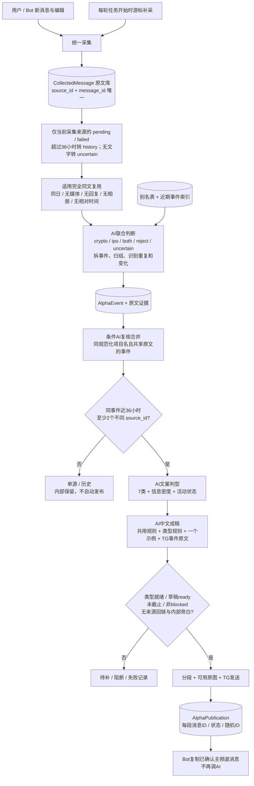
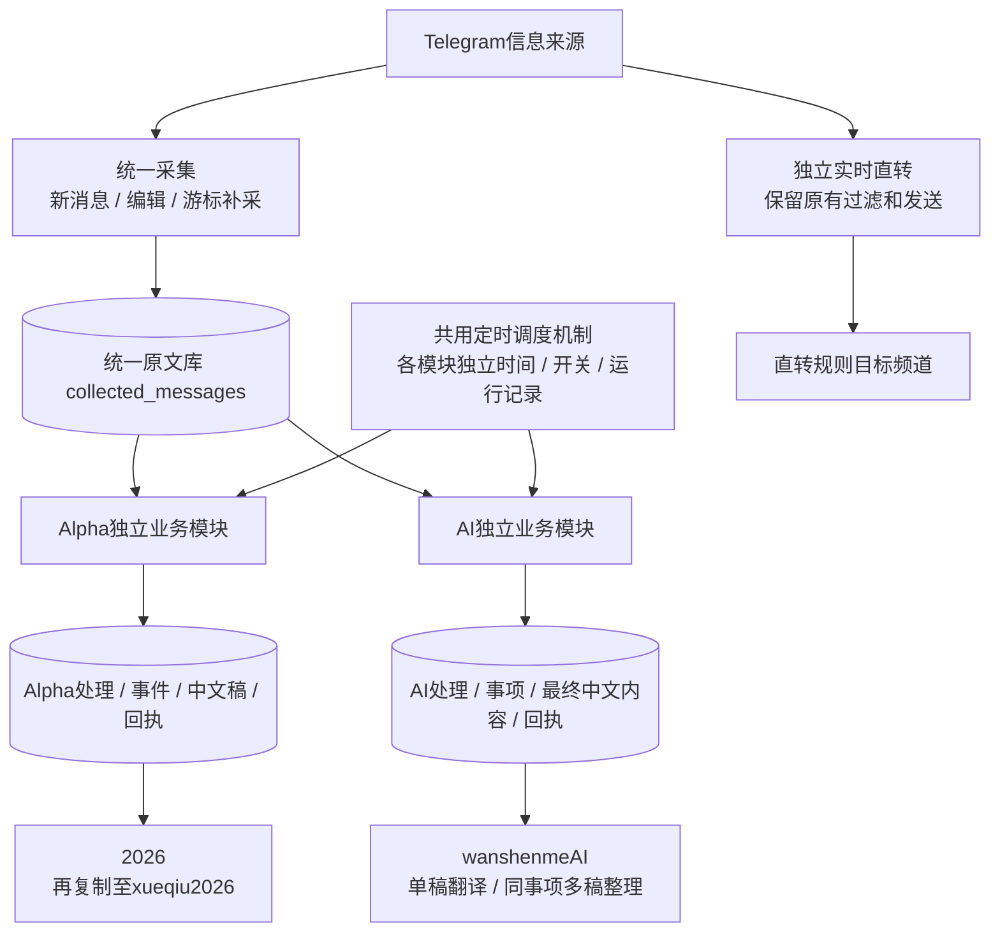
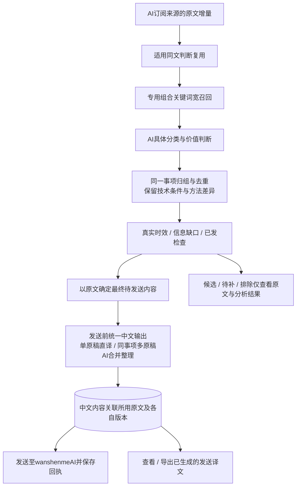

# P19｜当前架构与 AI 版块扩展检查

代码与现场核对日期：2026-11-25，北京时间；目标方案更新日期：2026-11-26。采集与处理架构核对基线为服务器快照 `4c443cc`；改造前调度基线为 `d4244de`；2026-11-26已部署P19代码 `2b2af65`，上线记录见§9末。

本文件区分改造前实现、现场快照和已确认目标。2026-11-26已按§6完成本地实现、隔离验证、GitHub推送及服务器部署；AI真实任务与发送结果见§9末和唯一执行清单。后续架构核对优先读本文；P12 保留此前设计与实施记录。

**最新讨论结论：§6为用户已确认的目标架构，取代此前“保留旧聚合”的建议。统一采集 → 统一原文库 → Alpha / AI两条独立业务链，共用调度机制；实时直转保持独立。旧聚合链路完整移除；AI在最终待发送事项确定后才输出中文：单原稿直译，同一事项多原稿由AI合并去重、整理成一条；采集、筛选、分类、归组和选稿过程中不翻译，最终文风与排版标准后续讨论。§1–§5描述改造前代码与现场快照。本地代码已按§6改造并移除旧聚合运行链，P19已部署到服务器；真实AI任务正在验证，当前状态见§9末。**

## P20 控制台本地改造补充（2026-11-26）

本地控制台实现与唯一执行清单见 [P20](P20-iOS平铺控制台前后端与链路改造方案-20261126.md#9-唯一执行清单)，尚未部署。新增统一TG目录和多分组、独立业务订阅入口、动态来源刷新、原文分页和已发回执读取；旧规则不再写业务采集开关。已有用户客户端经主进程桥接同步目录，未新建TG会话；已确认退出来源不自动Join。业务流水线、筛选、Prompt、模型值、发布目标、默认07/13/19/22与AI增量/不回捞失败口径保持。生产仍以P19已部署记录为准，不将本地页面验收视为生产验收。

## 1. 结论与现场状态

目前是一个 Python 主进程持有 Telegram 用户与机器人客户端，另以 spawn 启动 FastAPI 子进程；React 提供管理页面。业务上保留三条链路：实时直转、旧聚合总结、Alpha 机会处理。AI 新版块目前只有本地离线实验与方案，没有生产处理链。

以下为2026-11-25的只读数据库快照；定时时刻一栏包含此后已部署的22:00更新，其余运行状态未在2026-11-26重新查询：

| 项目 | 核对快照 / 已部署更新 |
|---|---|
| 服务 | `telegram-forwarder.service` 为 active/running；只代表进程状态 |
| 规则 | 共 57 条，全部开启规则及独立采集，关闭直转、关闭旧总结 |
| 采集来源 | 57 个 active 来源；新 AI 分组的 45 个来源尚不是一条独立生产流水线 |
| Alpha 任务 | 定时及发布均启用；模型 `gpt-6.1-sol` |
| 定时 | 北京时间 07:00、13:00、19:00、22:00；30 秒检查槽位 |
| 主目标 | `2026`，配置目标 ID `-1003905915992` |
| 同步目标 | `@xueqiu2026`；复制主频道已发内容，不再调 AI |
| 最近一轮 | 11 月 25 日 19:00 槽位，19:00:17 开始；结果 `partial` |
| partial 的依据 | 补采错误 0、分析错误 0、草稿错误计数 2、主频道发送 1、发送错误 0、未知回执 0；草稿错误计数包含 blocked，不能直接解读为模型调用失败 |

这些计数是核对时的快照，不是长期保证。采集与任务使用数据库、环境变量配置；Git 代码一致不代表各环境业务配置完全一致。

## 2. 当前进程与业务架构

```mermaid
flowchart TB
    TG[Telegram 来源频道与群组]
    UI[React 管理网站]
    WEB[FastAPI 子进程\n规则 / 机会 / 原文 / 导出 / 日志]
    BRIDGE[主进程内部 HTTP 桥\n默认 127.0.0.1:8001]
    DB[(同一数据库)]
    subgraph MAIN[main.py 主进程]
        CLIENT[Telethon 用户客户端 + Bot 客户端]
        LISTEN[message_listener.py\n新消息 / 编辑消息]
        POLL[条件轮询兜底\n只扫描未进入 MessageBox 的启动来源]
        COLLECT[alpha.storage\n采集 / 编辑 / 游标补采]
        LEGACY[旧实时直转\n用户原样路径 / Bot过滤器链]
        SUMMARY[旧 SummaryScheduler]
        ALPHA[Alpha 定时 / 手动任务\nrun_pipeline]
        MIRROR[镜像任务\n每30秒检查已发记录]
    end
    TG --> CLIENT --> LISTEN
    CLIENT --> POLL --> LISTEN
    LISTEN --> COLLECT --> DB
    LISTEN --> LEGACY
    DB --> SUMMARY
    DB <--> ALPHA
    ALPHA --> CLIENT
    CLIENT --> PRIMARY[2026 主频道]
    DB --> MIRROR --> SECOND[@xueqiu2026]
    UI <--> WEB
    WEB <--> DB
    WEB --> BRIDGE --> ALPHA
    PROVIDER[ai/ 模型适配\nOpenAI / Grok 等] <--> ALPHA
    PROVIDER <--> SUMMARY
    PROVIDER <--> LEGACY
```

图中旧路径表示代码仍保留，不表示当前有任务发送：目前 57 条规则的 `enable_forward=false`、`is_summary=false`。FastAPI 操作通过桥接进入持有 TG 客户端的主进程，不另外登录一个 TG 会话。

`main.py` 仍调用 `start_message_poller`。其轮询间隔是每轮扫描后等待 15 秒，另有逐频道等待，并非所有来源固定每 15 秒扫描一次。P17 是“待执行”的历史关闭建议，不能据文件标题认定当前 Poller 已关闭。

## 3. 当前 Alpha 的实际处理顺序



需要明确的几处实际行为：

- **Alpha 当前没有关键词预筛。** `filters/keyword_filter.py` 属于旧实时直转过滤器链，没有被 `alpha.pipeline` 调用。不能把离线实验词表当成已启用的线上过滤。
- **不是每条信息固定只调一次 AI。** 当前有联合分析、门槛后文案判型、中文成稿三种常规调用，另有条件式事件合并调用；分析和判型按批，成稿按事件，均存在适用缓存。
- 联合分析默认每批 12 条代表消息；判型每批最多 12 个事件。原文数量、独立事件数量、API 请求数不是同一个计数。
- 完全同文复用有明确限制，不是任意跨频道相似文都复用。内容有图、回复、相册、相对时间时仍需分析。
- 36 小时按消息发布时间计算，跨任务槽位累计来源；采集本身不只保留 36 小时。
- `consolidate_events` 是补救误拆的有限合并，不是全库语义去重；同项目但无共享原文、别名未归一时，不一定触发这层复核。
- 当前 7 种文案类型为：活动教程、发行与申购、资格查询与领取、积分与分配、重要进展与提醒、全球 IPO、平台上线预告。
- 成稿事实来自保存的 TG 原文及实体链接。当前主流水线没有自动搜索 X、打开外链核验或对图片做 OCR；示例仅控制写法，不是事实来源。
- 发送前可取回一张适用原图；图片不等于已被 AI 阅读。综合帖跨项目时不随意拿图片做封面。
- `unknown` 发送结果先对照频道近期历史，不自动盲重发；主频道和镜像各自保存回执。

## 4. 模块与数据边界

| 职责 | 主要代码 | 数据 / 接口 |
|---|---|---|
| 主进程、TG登录、桥接、子进程启动 | `main.py` | `/alpha-run`、`/health`、`/trigger-summary` |
| 新消息、编辑及旧转发分流 | `message_listener.py` | 用户 / Bot 监听入口 |
| 采集、补采、编辑失效、来源统计 | `alpha/storage.py` | `collected_messages`、`alpha_collection_state` |
| 分析、同文复用、任务总编排 | `alpha/pipeline.py` | 原文分析字段、`alpha_events` |
| 有限事件合并 | `alpha/consolidate.py` | 同项目共享证据事件 |
| 主题与成稿基础 Prompt | `alpha/prompts.py` | 分析 / 合并 / 成稿版本 |
| 门槛后判型、7类规则与示例 | `alpha/editorial.py` | `content_type`、`editorial` |
| 公共文案检查 | `alpha/public_copy.py` | 内部处理说明检测；另有成稿来源检查 |
| 定时任务与排他锁 | `alpha/scheduler.py`、`alpha/pipeline.py` | `alpha_job`；PG advisory lock / SQLite文件锁 |
| 发布、图片、分段与回执 | `alpha/publish.py` | `alpha_publications` |
| 主频道同步 | `alpha/mirror.py` | 已发主消息ID → 目标消息ID |
| 模型路由与调用 | `ai/`、`alpha/model.py` | 模型配置、JSON输出校验、usage |
| 网站机会页面/API | `frontend/src/pages/AlphaPage.tsx`、`rss/app/routes/alpha.py` | `/api/alpha/status`、`config`、`run`、`export` |
| 旧实时直转 | `handlers/user_handler.py`、`filters/process.py` | `ForwardRule`、关键词/替换/AI/RSS等 |
| 旧聚合总结 | `scheduler/summary_scheduler.py` | `forwarded_messages`、`summary_history` |

当前所谓“统一原文库”在存储上去重，但采集入口、来源状态和分析字段仍明显带 Alpha 业务耦合，尚不是完全通用的多版块框架。

## 5. 更新前检查结果

### 必须在接入新 AI 版块时解决

1. **来源没有业务隔离。** `sync_sources` 将所有开启规则且 `enable_collect=true` 的来源纳入同一 active 集合；`analyze_pending` 直接读取该集合。不能仅给 AI 分组打开采集，就认为它只会进入 AI 链。
2. **原文只有一套分析状态。** `CollectedMessage` 的 `analysis_status / analysis_version / analysis / usage / error` 当前由 Alpha 写入；AI 版块必须拥有独立处理记录，不可覆盖这些字段。
3. **任务与发布配置只有 Alpha 单例。** `AlphaJob(id=1)`、固定07/13/19/22调度和 `AlphaPublication(event_id,target_id)` 都是当前机会业务对象；AI 的目标、任务状态、规则版本和发布记录要独立。
4. **Alpha硬门槛不可复用成AI资格。** 36小时过滤、至少2来源、7种机会文案均有明确业务含义。AI版块取消这两个门槛，不能通过全局改常量来实现。

### 当前能力的限制与需要注意的点

- 采集保持原文一次入库，但实时、轮询和补采可能收到同一消息，由唯一键及内容版本处理；这不等于 TG API 只会读一次。
- 轮询的来源名单来自启动时的 `source_ids`，不是 AI 分组的自动动态订阅。新分组来源如何纳入生产必须显式接通。
- `candidate_context` 的历史全文展开仍依赖项目名/别名或相同URL；小型事件索引会提供给AI，但无词面命中的旧事件缺少全文上下文，存在漏归组边界。
- 一源事件不会自动生成公开稿；有活动但事实不足时会阻断。不能为凑每日数量放宽现有 Alpha 标准。
- 原文编辑会使证据和草稿失效；但已经 `sent` 的发布记录会直接跳过，不会自动撤回或编辑历史 TG 帖子。稿件失效与已发帖修订是两个能力。
- 新AI线没有正式网站入口、调度器或TG/X发送链。现有项目只有TG发布，不能把“文案可发X”表述成已支持X自动发布。
- 旧总结代码仍可由旧入口手动触发，执行时对 Alpha 主目标另有阻断；快照中无 `is_summary=true` 的规则。用户最新决定将其整条链路移除，清理范围见§6；生产删除尚未执行，本地代码清理状态见§9。
- 文档存在历史状态及编号冲突：服务器旧P13是轮询方案，本地新P13是AI筛选方案。阅读以标题和日期区分，后续统一整理；此次不重编号用户已确认文档。

## 6. 已确认目标架构与更新方案（已实现并部署，执行记录见§9）

### 6.1 统一采集和原文，业务独立，直转独立

统一采集负责接收TG新消息、编辑及历史补采；统一原文库负责保存正文、来源、链接、媒体标识和当前revision；当前实现不是完整的历次正文快照库。原文在PostgreSQL的`collected_messages`保存，同一来源同一消息只存一份。图片主要保存媒体标识，发送时取回原图，不把“保存媒体信息”视为已做OCR。

统一原文库之后只保留Alpha与AI两个同级业务模块。旧聚合不再作为第三个模块保留，也不再接入新的统一调度。实时直转继续独立，可共用现有TG客户端，但不依赖Alpha或AI任务，不因直转再写一份原文。



此图表示已确认目标；本地实现与生产部署状态分别见§9。网站为配置、手动执行和查看入口，桥接只负责把网站请求交给主进程；二者不混入主业务顺序。

### 6.2 数据分表与独立管理

“分表”指业务状态、分类结果和成稿分开，不是复制两份原文，也不是拆成两套数据库。以下为逻辑划分；新增表名供实施时落定。

| 数据职责 | Alpha | AI | 共享方式 |
|---|---|---|---|
| 当前原文及revision | 读取同一原文 | 读取同一原文 | `collected_messages`不再承担业务分析状态 |
| 来源归属 | Alpha订阅集合 | AI订阅集合 | 一个来源可同时订阅，采集取两者并集 |
| 处理结果及版本 | 独立Alpha处理表 | 独立AI处理表 | 引用原文ID和已处理revision，不相互覆盖 |
| 归组及中文输出 | 保留`alpha_events`等现有中文成稿能力 | 新增AI事项、分类及最终中文内容 | 各自规则、Prompt版本及待补原因；AI最终成稿另议 |
| 任务配置与运行结果 | 保留Alpha配置并适配共用调度 | AI独立配置和运行结果 | 共用调度机制，各自开关、时刻、锁和状态 |
| 目标及发布回执 | Alpha主频道与镜像记录 | AI频道及发送记录 | 复用必要发送基础能力，业务回执独立 |

现有`CollectedMessage.analysis_status / analysis_version / analysis / usage / error`迁入Alpha处理表，保留既有结果、失败续接、同文复用与usage，不默认全量重跑。AI另建处理表，不能占用原文表旧分析字段。原文编辑后，分别将订阅该消息的业务处理状态标为需重算；不把某条业务的reject/history状态传播给另一条。

### 6.3 共用调度机制，独立执行与发送

- 共用的是到点触发、手动入口调用和任务状态管理机制，不是将两个模块串成一个大任务。
- Alpha执行时间为北京时间07:00、13:00、19:00、22:00；用户已确认AI先默认使用相同的四个执行时间。共用调度机制，各模块独立配置与执行，同一时刻不意味着串成同一个任务。
- 两个模块各自读取未处理增量、失败待续接记录及受编辑影响记录，各自维护上次槽位；不互相覆盖或因为一个模块失败把另一模块判为失败。
- Alpha继续执行36小时、至少2来源、既有7类文案和已发去重；AI不采用双源资格或36小时淘汰。新增AI不改变Alpha筛选口径。
- 定时任务直接在持有TG客户端的主进程执行；网站手动触发才经过内部桥接。

### 6.4 AI现阶段：过程使用原文，最终同一事项只输出一条中文



**用户已确认：最终同一事项只发一条。单原稿忠实直译；多条原稿确实讨论同一事项时，最终由AI去重、保留互补信息并整理成一条中文内容。采集、关键词召回、AI分类、归组、时效判断和选稿全部直接使用原文，不提前翻译全文、事项或候选预览。最终文风、排版和分类写作模板后续讨论，Alpha既有中文成稿流程不变。**

- 中文输出仅针对本次最终确定发送到TG的事项，保留步骤、条件、数字、链接和信息密度，不压缩成一句导读；不逐条翻译未选中、待补、排除项或同事项各转载副本。
- 保留资格、权益、数字、费用、限制、时间及原文已有的不确定语气；不添加原文没有的背景、判断、结论或操作步骤。
- 产品名、模型名、代码、命令、参数和链接保持准确；单原稿已是中文时无需翻译，不强行重写；同一事项有多条中文或中外文原稿时，仍按同事项规则去重整理为一条。
- 确认同一活动/版本/资格/阶段，或同一环境和方法的多条原稿，最终可由AI在一次输出中合并重复、保留有原文依据的互补信息并转成中文；不用先逐篇翻译再另调一次模型合稿。最终内容关联所用原文ID和各自revision，并保留实际发送正文及分段；不能只依靠会被编辑覆盖的当前原文追溯已发内容，也不因此新增完整历史版本系统。不虚构背景或把冲突事实强行统一。不同版本、资格或技术路径不因同品牌硬并。
- 数据库保留原文和分析结果；只有进入最终发送阶段才生成并保存对应译文。原文编辑后先使旧结果失效、重新筛选；只有再次确定发送时才按新版本生成译文，不对全部候选自动重译、不覆盖原文。
- 翻译输出不附加内部筛选、翻译、核对过程说明。公开发送时继续遵守已确认的不展示采集频道署名与采集原帖回链要求，不扩大为删减正文中的有效操作链接。
- 网站核对页用于查看和校准，不把长期逐条人工批准新增为自动发送前置条件。
- 本阶段落实忠实中文输出和同事项多原稿整理；面向TG/X的文风、排版及分类写作模板后续讨论，X自动发布仍不在本次范围内。

**同事项整理示例（虚构，仅说明规则）：** 来源A说“工具A新用户注册赠25美元API额度”；来源B补充“邮箱注册后获取API Key”；来源C补充“本次赠额有效期7天”。确认三条说的是同一活动、同一资格后，最终只输出一条：“工具A新用户注册可获25美元API额度。使用邮箱注册并获取API Key后使用，赠额有效期7天。”重复的25美元不累计为50或75美元。若另一条写的是“充值后赠额”，不能混入“注册即赠”的同一条件。

AI筛选口径沿用用户已确认方案：B1注册/申请赠API额度、B5身份/地区/渠道领取、B6登录/邀请/老用户新增权益、T1接入/环境配置、T5 Token/速度/额度优化、T7注册/订阅/资格/账单，以及 U 热门模型实质更新/额度重置。福利和方法不限定热门品牌；只有 U 限定 Claude、GPT/ChatGPT/Codex、Grok、Gemini 等已确认范围。

7D 是首次历史重筛范围，日常只分析上一任务边界之后、本次任务边界及之前发布的新增原文；历史失败和积压不自动回捞，原文、状态和错误记录保留。2026-11-26用户确认：失败批次也不在下一轮自动重试，普通“执行一次”同样走增量，不新增网页/API/CLI手动重跑功能。批次边界在模型调用及采集补缺前持久化，避免失败或中断后重复消耗；首次无执行记录时从业务订阅启用范围处理，已有AI任务升级时以原last_run初始化边界。统一采集补缺与发送回执/未知结果处理不变，Alpha保持既有36h和失败续接口径。取消36h不等于发布已失效活动。每天1–3条是用户期望的内容产出，不能当作无条件保证或自动降低质量门槛。用户已确认AI默认按北京时间07:00、13:00、19:00、22:00执行，与Alpha相同；该配置已在本地代码实现，尚未生产启用。

### 6.5 旧聚合链路完整清理范围

删除整个旧聚合功能，而不是仅把`is_summary`关掉。范围覆盖：

1. `SummaryScheduler`及主程序启动、停止、任务注册和执行引用。
2. 内部`/trigger-summary`、网站`/trigger-summary-now`、Bot“立即总结”回调、旧定时配置及其他手动触发入口。
3. 简报、推文工厂、信息差快报旧Prompt及其默认常量、配置字段、前端表单、类型与API传递。
4. `log_forwarded_message`和`MessageLogFilter`等只为旧消息表落库的入口，包括直转关闭分支中的旧总结落库；保留直转自身过滤、发送和必要日志。
5. `ForwardedMessage`、`SummaryHistory`及旧字段/关系/建表迁移引用。实施时先梳理实际依赖：当前沙盒频道列表、样本读取、训练输入和总结历史页面也使用旧表；有用的原文读取迁到统一原文库，旧聚合专属页面/API删除。不能只删模型而留下悬空调用。
6. 确认无运行读写依赖后，备份/导出旧数据，再通过明确迁移删除废弃表和列；不删除有效原文、Alpha业务数据、TG会话及直转规则的其他数据；本方案明确的Alpha分析字段迁移等结构变更仍须实施，不能将“不删业务数据”理解为“不改表结构”。旧数据备份仅作历史留存，不作为继续运行的旧链。
7. 清除废弃测试与导入，历史文档标为已废弃并指向P19；不让初始化迁移重新建回旧表或旧字段。

补充已确认的代码依赖：`handlers/button/settings_manager.py`的总结按钮定义、`button_helpers.py`的时间分页、`callback_handlers.py`回调注册、`ai_callback.py`总结设置/立即执行、`handlers/prompt_handlers.py`总结输入状态、`utils/common.py`的设置展示，以及`utils/settings.py`、`utils/file_creator.py`中的旧时间表读取/生成都要清理。网站还有规则批量复制/同步字段、删除规则时的`SummaryHistory`解绑、`/summaries`页面/API、`/sandbox/apply-prompt`批量写旧Prompt；旧迁移工具`scripts/migrate_sqlite_to_pg.py`和根目录`test_summary_push.py`也引用旧模型。不能只删除`scheduler/summary_scheduler.py`。

保留共用能力：`ai_callback.py`同时包含直转AI设置，`filters/ai_filter.py`属于独立直转，`ai/`是两条业务都需要的模型适配。按引用精确删除旧聚合部分，不能按“AI”“summary”关键词整文件删除；失效的旧常量导入需一并移除，不能因删常量导致直转模块无法导入。

旧聚合删除、Alpha状态迁移、AI接入和共用调度需要合并核对，避免删掉仍被沙盒或直转引用的旧落库函数。本地已实现清理代码及显式数据库迁移，生产数据库和服务器尚未执行，见§9。

### 6.6 实施顺序与完成口径

1. 核对旧聚合调用及旧表依赖，完成数据迁移设计；提取采集和调度中的必要共用能力，不重写整个项目。
2. 增加业务来源归属、Alpha/AI独立处理表，将Alpha分析字段和结果迁出原文表；采集取并集，Alpha仍只处理原有来源。
3. 将仍需保留的原文查看/沙盒读取迁到统一原文库，再完整删除旧聚合运行链、配置入口及废弃数据库对象。
4. 接入AI已确认词表、分类、事项归组、最终中文输出、查看页、目标和回执；只在确定最终待发送事项后翻译单原稿或整理同事项多原稿，过程中不翻译。接入共用定时调度，Alpha、AI独立运行。
5. 按完整链路验收：同一原文不重复入库，两模块状态不互相覆盖；Alpha规则和独立直转保持原行为；AI按独立规则使用原文筛选，最终发送阶段才生成中文，同事项多原稿合为一条且不丢失互补信息；旧聚合无残留触发、落库或发送入口。代码、迁移和部署是否已完成须分别记录，不以文档更新代替实施。

### 6.7 待讨论项与已确认边界

仍待讨论：

- AI每天1–3条目标下的选稿优先级；当前不额外设每日硬上限，也不为凑数降低筛选要求。
- AI最终文风、分类写作Prompt、排版、长度与配图方式。
- Alpha资格查询与Mint参与等阶段漏斗后续单独优化，本次架构更新保持现行规则。
已确认、不再待定：

- AI默认执行时刻为北京时间07:00、13:00、19:00、22:00，与Alpha相同，各自独立配置和执行。
- 翻译时机及对象已明确：综合帖在原文筛选和选稿阶段确定最终发送内容，翻译阶段只翻译这份待发送内容，不替选稿重新决定翻译范围。
- 同事项多原稿处理已确定：最终由AI整合为一条中文内容，不需要在不同原稿中机械选一条，也不把同组原稿分别推送。仍须保留不同技术条件、资格及版本的区别。

### 6.7.1 已记录的中文表达问题（2026-11-26，后续优化）

用户对ChatGPT Business权益示例反馈：机械直译不够流畅，读者不容易理解。截图中的“为ChatGPT Business团队提供两项福利：一次可存储的重置机会……”和“赠送1张重置卡，仅限ChatGPT Business订阅席位……”暴露出术语生硬、对象关系不清及句子衔接不自然的问题。

- 将`banked reset`直接写为“可存储的重置机会”，中文难以理解；“重置卡”“订阅席位”等表达也需要结合原文产品语境解释，不能只逐词转换。
- 后续需要在保留事实和信息密度的基础上，优化自然中文、术语说明与叙述顺序；不同来源表达同一权益时，应统一表述，不能机械拼接句子。
- 这是一项待优化反馈，不把直译示例当成已认可的最终文案标准，也不在本次自行落实新的写作模板或提示词。
- 现阶段仍只在最终待发送事项确定后生成中文，同一事项多原稿整理成一条；筛选、分类、归组过程不翻译。此项中文表达反馈仅记录，本次代码接入未做这项文风优化。

### 6.8 代码复核补充：实施时不能遗漏的依赖

本节记录落实既定架构的技术依赖和检查建议，不新增业务筛选条件、自动推送规则或最终成稿标准；待讨论项仍按§6.7处理。

#### A. 原文分析字段迁移不是只换一张表

| 改造前使用位置 | 必须配套处理 |
|---|---|
| `alpha/storage.py:76` | `save_message`会重置原文分析状态、`detach_evidence`直接操作Alpha事件；将原文保存与各业务失效处理分开，保留编辑revision语义 |
| `alpha/pipeline.py:207` | 待处理查询、缓存命中、批次提交、usage、失败续接改读写Alpha处理记录；不能漏掉模型/规则版本 |
| `alpha/consolidate.py:63` | 合并事件时会回写`row.analysis`里的事件ID，需迁到Alpha处理表，保持原文证据引用 |
| `alpha/publish.py:30` | 配图会读`row.analysis`判断是否为多项目综合帖；漏迁会报错或把无关图片当封面 |
| `alpha/storage.py:201` | `snapshot`统计目前直接读原文分析状态，迁移后网站统计必须限定所属业务 |
| `alpha/__main__.py`及测试 | CLI状态/导出/运行入口、API与夹具要随模型迁移，不能只证明主流水线能调用 |

独立处理表至少需要原文ID、已处理revision、状态、规则/模型版本、结果、usage与错误；仅最终发送阶段产生的译文记录翻译版本和对应revision，未入选内容不要求有译文。仍沿用现有缓存/续接思路，不为本次新增通用插件或工作流框架。数据库迁移先保留原文ID、事件ID、已发送回执和采集游标，再切换读写，核对成功后删除废弃字段；不能通过重建空表丢失既有进度。

#### B. 业务来源与采集游标要同时解耦

- 当前`alpha.storage.sync_sources`由启用的`ForwardRule.enable_collect`推导来源，`main.py`启动注册/轮询也只查转发规则；只新增AI来源表而不调整这两处，来源可能未激活或被Alpha混读。
- 业务来源归属独立于直转规则和目标频道，不为采集AI来源建立虚假的直转规则。采集使用Alpha/AI启用来源的并集；一个模块关闭后，另一模块仍订阅的来源继续采集。
- 当前`AlphaCollectionState`既保存采集游标又被`is_migrated`用来阻止旧落库；删除旧落库后应解除这层业务用途，但保留已确认游标与启用时间，不能重置后漏采或重扫全部历史。
- 同槽位两个业务不能各自再创建TG客户端、各补采一遍全来源；统一采集/补采负责原文，业务模块只读取自己的增量。手动触发也复用同一采集协调入口。
- 首次AI接入不能直接假定“启用后”就包含过去7天：当前补采按`enabled_at`起算，前期7D实验材料部分在本地`output/`，并非已全部导入生产原文表。先核对可复用数据和缺口，历史导入独立记录范围，不把历史候选当作新消息自动全量发送。
- 保持既有明确排除的`@korean_alpha`，不因新来源归属迁移重新激活。

#### C. 共用调度的具体边界

- `RunLock`当前使用固定PG锁`72119036`及Alpha文件锁名。AI不能照抄后与Alpha抢同一业务锁；共用锁实现，业务运行锁独立，采集协调单独处理。
- `main.py`手动入口内的`alpha_runs`、`/api/alpha/run`、CLI与定时任务应指向同一业务执行函数。增加AI后要有明确模块入口，不能把旧“立即总结”按钮直接换文字却仍调用旧聚合。
- 当前`alpha/scheduler.py`在调度循环开始处读库，读库异常不在后面的任务异常捕获范围内；从代码可见该异常会使这个后台循环退出。共用调度改造时需覆盖“一个模块配置/读库异常后能继续调度”的定向验证；本轮未复现或判定生产发生过该故障。
- 当前失败轮也写`last_slot`，通常下一槽位或手动执行才续接；“失败续接”不等于当晚自动不断重试。保留Alpha现行口径，不自行新增高频重试、补跑全部历史槽位或强制两模块串行。

#### D. 最终中文输出与发布的接口不能只传正文

- 原文中的隐藏链接在`entities`，不一定出现在`body`。翻译输入和呈现需携带正文及实体链接，核对UTF-16偏移/中文译文后的链接位置；不能只把`body`交给模型而丢掉领取入口。
- 最终待发送内容确定后才生成并保存忠实译文及原文关联，公开发送按既定要求处理采集署名/回链。不能为中间核对页面预先翻译全部候选，也不能为清理公开尾签覆盖原文或改成摘要。
- 分析阶段复用适用的AI业务判断，不提前生成译文；发送阶段可复用同内容同翻译版本的已有译文，发送重试不重复翻译。不能把Alpha的`reject`复用为AI排除，也不能只按产品名称复用技术内容。
- AI技术原文可能含命令、代码块及很长链接；TG分段需保留实体和可复制内容。复用现有发送基础函数前核对格式适用性，不直接套用Alpha文案类型和配图项目判断。
- 当前`AlphaPublication`由Alpha事件ID与目标唯一约束，不能把AI事项ID填进去；AI独立回执记录消息ID/分段/状态，已发和未知结果不盲重发。
- 候选/待补/排除页面展示原文、分类、简短理由及版本，不为浏览生成中文正文或长导读；已进入发送阶段的内容可查看对应译文。旧沙盒“应用到所有规则”的入口不能覆盖Alpha/AI两条业务Prompt。

#### E. 实施验收与回滚边界

复用现有测试工具，补查与本次直接相关的路径：旧聚合删除后模块导入和初始化不再建回旧表；独立直转仍能处理；一个原文同时进入Alpha/AI且互不改状态；原文编辑后两边分别失效；原图与隐藏链接未丢失；同槽位各任务不重复执行；已发回执迁移后不重发；沙盒/网页统计与导出读对业务数据。最终中文输出用固定单原稿、同事项多原稿及链接核对，覆盖中外文混合、技术条件差异和冲突信息；不把真实活动核验扩大成本轮目标。

部署需保留同版本代码与数据库迁移回滚办法；只回退旧代码但不恢复被删除的表/列会导致无法启动。首次启用不得因旧`last_slot`或历史导入意外批量发送。AI默认时刻已确认与Alpha相同；同事项多原稿最终整理为一条已确定，翻译时机仍为仅最终发送阶段，方案核对阶段未执行改造；后续本地代码实施状态见§9，生产部署仍未执行。

### 6.9 方案复核记录（代码实施前）

- [x] **通过**：代码依赖与方案一致性检查，补齐旧聚合清理、字段迁移、来源/游标、调度与最终中文发布接口范围。
- [x] **通过**：纠正AI处理顺序，与AI筛选方案保持“原文去重/复用 → 关键词宽召回 → AI分类 → 事项归组 → 时效/已发检查 → 原文选稿确定最终发送事项 → 发送前直译或同事项多原稿合并中文输出”，不引入最终润色成稿。
- [x] **通过**：2026-11-26最终文档核对，统一架构图、实施步骤和验收中的中文输出口径，明确中文原稿归并、当前revision与已发正文保存边界；区分快照、已部署调度和未实施目标。
- [ ] **未执行**：代码改造、数据库迁移、生产部署与真实发送验收；当前仍为讨论方案。
- [ ] **未执行**：Alpha资格查询/Mint阶段漏斗优化，按用户要求后续单独讨论。

## 7. 核查依据与验证范围

- 静态检查已覆盖：主程序与监听入口、采集/补采/编辑、分析复用、事件合并、判型与提示词、发布与镜像、模型路由、数据库模型、Web API和旧总结边界。
- 现场仅做只读查询：当前规则开关、采集状态、Alpha配置、最近运行结果、发布状态及相关业务表。
- 历史验证：服务器基线同步时159个选定文件逐一校验一致；`d4244de`阶段Alpha 52项与前端构建通过，连接检查4项为此前结果。上述检查证明其对应版本与范围，本轮未重新运行，不证明尚未实施的新架构已经通过。此次仅核对文档，没有调用模型或发送测试消息。
- 未做新一轮自然定时观察、真实外部API调用、浏览器交互或发送测试；因此本文不作“全部业务无错误”的保证。

核心代码入口：`main.py:368`、`message_listener.py:81`、`alpha/storage.py:44`、`alpha/pipeline.py:207`、`alpha/pipeline.py:368`、`alpha/editorial.py:84`、`alpha/publish.py:44`、`models/models.py:104`。

## 8. 2026-11-25 定时增量更新

用户确认新增北京时间22:00，Alpha每日执行时刻变为07:00、13:00、19:00、22:00。此次只增加调度时刻并同步网页说明，36小时、双来源、资格查询与Mint阶段漏斗均保持现状。部署晚于当天22点时不因新增槽位立即补发，后续时刻照常执行。

## 9. 2026-11-26本地代码执行状态

唯一执行清单：[P19-代码更新执行清单-20261126.md](P19-代码更新执行清单-20261126.md)。当前改动尚未提交或部署；原已部署基线`d4244de`不包含本节代码。

- 共享采集在`collection.py`，原文仍唯一存储于`collected_messages`；`business_sources`记录独立订阅，Alpha状态移至`alpha_processing`，AI独立使用`ai_processing/ai_items/ai_job/ai_publications`。保留原Alpha采集游标表名以便迁移，不因名字继续承担Alpha资格判断。
- 旧聚合调度、手动/Bot入口、规则配置、落库链、ORM模型和旧专用补采/试发脚本已从本地运行代码移除；沙盒读取改读共享原文，生产旧表暂未操作。删除只由备份后的显式迁移命令完成。
- 共用调度机制、各自运行锁/时刻/状态，默认07/13/19/22；同槽位共用一次补采结果，采集错误按各自业务来源报告。独立直转和Alpha既有筛选、成稿、镜像规则保持。
- AI仅在最终发送阶段生成中文，按同事项整理、保留技术差异；新增AI内容页、API、CLI和主进程手动桥接，默认定时与发送关闭，不自动导入或发送历史7D内容。
- 本地72项测试及前端构建通过。隔离SQLite验证覆盖数据迁移与备份恢复、原文唯一性/编辑、业务状态隔离、归组、缓存、失败续接、发送回执和未知结果处理；本地实际HTTP请求已走通网站API→主进程桥接→流水线→回执→查看/导出。模型与TG边界使用固定测试输入/替身，未宣称真实API质量或真实频道送达。
- PostgreSQL迁移/恢复、生产部署、真实模型/频道发送及自然定时观察未执行；本机缺少PG工具，需上线前补验。文风/配图/优先级和Alpha阶段漏斗仍按§6.7后续讨论。

### 2026-11-26补充：AI批次边界更新

按执行清单第25项完成本地修改：AIJob新增`analysis_until`，普通任务仅处理`(上一边界, 本次边界]`内的pending原文；在外部调用前保存新边界，历史failed及旧pending不自动重试。已有AI任务升级时从`last_run`初始化边界，不重置原文、来源和处理结果。普通网站/CLI/定时入口共用该规则，不新增手动重跑入口；Alpha、统一采集和发送回执处理不变。隔离SQLite迁移及批次验证、网站API到主进程链路验证（模型/TG替身）、P19 21项和Alpha 50项检查及前端构建通过。未部署、未做PG及真实频道验证；此前审查的关键词分流、事项缺口/截止覆盖、发送前状态复核问题仍待单独修复，本补充不表示P19整体验收通过。

### 2026-11-26追加部署授权与上线前检查

用户已授权测试后推送GitHub、部署服务器，并实际推送一次到“今天玩什么AI”@wanshenmeAI（已核对稳定ID -1006011218216，BOT具有发消息权限）。已修复关键词分流、事项缺口/截止覆盖和发送前状态复核问题：hit完整分类，needs_check低篇幅补判，unmatched每来源每任务抽取最早一条低篇幅抽查；补判命中才完整分类，其他原文保留。事项合并保留未解决缺口及已有截止；最终生成后重新检查状态/截止。服务器隔离PG迁移及备份恢复验证通过，生产切换和真实发送以执行清单后续状态为准，不增加重跑入口。

### 2026-11-26服务器部署记录

- GitHub及服务器业务代码：`2b2af65`，含P19主体`69fd348`、频道ID兼容修复`a90364c`及BOT发送修复。启动时统一业务来源ID，并转换为Telethon使用的频道ID进行MessageBox/PTS检查，避免同频道重复注册；已补真实启动函数的隔离回归。最终80项后端检查通过，前端构建通过；含采集账号无发布权限时走BOT发送，以及BOT结果未知时用用户账号核对历史且不重复发送的验证。
- PostgreSQL：已停服备份并完成生产迁移；旧聚合表/字段已清理，Alpha原有数据和调度保留。迁移前另以两个隔离PG库核对迁移及恢复，保留4762条原文及revision、672个Alpha事件、113条发布记录和57个采集状态。
- 回滚目录：`/var/backups/tgbot-p19-20261126/`，含原代码、差异、生产整库备份和隔离验证结果。回滚必须停服并同时恢复代码与数据库。
- AI来源：从既有AI分组45项中启用44个有效来源；历史已退出的Not Boring Tech（-1001346439625）停用，已确认当前left=true。该历史退出来源保持停用。目标核对为“今天玩什么AI”频道@wanshenmeAI（-1006011218216），保留此前4条试发回执避免重复发送。
- 本次真实任务从上次实验结束2026-11-25 22:48:42北京时间开始增量，服务器主进程负责采集、分类和发送，本机关闭不影响执行。任务与真实发送结果以执行清单后续状态为准；未把任务运行中或API失败记为送达。

- 真实API核对：原OpenAI网关对gpt-6.1-sol返回502后长时间未完成；Grok接口返回密钥无效，因此未切换到Grok。AI当前使用已有配置gpt-6.1-terra，已用真实TG资料验证分类及中文生成；Alpha模型不变，未新增自动模型切换或重跑功能。首次中断批次8条补判失败留存、不自动重试；本次人工验收只完成7条尚未调用AI的原文，均因范围不符排除。
- 本次人工试发选用户此前明确保留且目标尚未发送的Dahl赠额原文（@AIShengzhang/84，原文时间2026-11-25 17:23:28北京时间），仅导入这一条并单独记录于服务器回滚目录的dahl-acceptance.json，未回扫7D或重试8条失败数据，日常增量边界不回退。
- AI采集继续使用主进程既有用户客户端；发布使用目标频道已授权BOT，未知发送结果用用户客户端读取历史核对。Alpha发送和镜像不变。实测首次用户账号发送被ChatWriteForbidden拒绝，已保存中文稿；BOT发送修复后复用该稿重试，不重新调用AI。最终发送回执和定时开关以执行清单为准。

### 2026-11-26真实发送验收结果

Dahl Inference验收稿已通过现有BOT发布链路送达@wanshenmeAI，AIPublication状态sent、消息ID 6，公开页面https://t.me/wanshenmeAI/6 可读取中文正文。BOT修复后的主进程任务已记录sent=1、发送errors=0；随后只读/复用核对未新增发送或AI调用。原文、分类、最终中文、实际分段和TG消息ID均有保存；未把所有历史候选批量发送。

模型网关在新内容补判中仍返回502，本轮保留10条失败记录，其中最初中断8条、后续2条；真实任务partial不等于发送失败，不能宣称所有消息处理成功或外部API稳定。gpt-6.1-terra已成功完成7条实际原文分类及Dahl分类/中文输出；Grok密钥无效未使用。AI本批错误统计随本批时间边界限定，旧失败保留历史，不导致以后成功批次永久显示partial；该定向修复26项检查通过。


## 10. AI每3小时定时与同事项去重增量方案（2026-11-26）

本节落实用户最新确认：AI每3小时执行一次；北京时间一天内不能出现重复内容。本节已获用户授权并完成本地代码与隔离验证，尚未提交、推送或部署；线上仍为原时刻。Alpha保持原定时、36h和至少两个来源要求；本节不改既有AI分类范围、模型、目标、最终中文风格或失败不回捞规则。

### 10.1 时间与增量范围

- AI北京时间01:00、04:00、07:00、10:00、13:00、16:00、19:00、22:00，共8次；沿用现有schedule_hours配置，不新建调度器。Alpha仍07:00、13:00、19:00、22:00。
- 普通任务继续处理`(analysis_until, 本次批次边界]`的新增待处理原文；没有新原文不调用分类AI，旧failed及边界前积压不自动回捞。不回退边界、不重扫7D、不为了新增时点补发历史。
- 待分析原文范围与去重参考范围分开：只分类新原文，但参考历史事项与已发回执；不能每3小时或每天午夜清空去重记忆。

### 10.2 同事项的判断标准

同一天按Asia/Shanghai自然日计算，转换为UTC查询，边界为当天00:00（含）至次日00:00（不含）。同一目标频道同一事项不重复发送；跨天没有实质变化也不能重新发送。不是按品牌名、频道名、链接是否一致或译文相似程度判断。

| 输入差异 | 处理 |
|---|---|
| 同一TG消息重复到达 | 复用原文唯一键，不增加原文行 |
| 不同频道转载同文 | 复用适用的已有分类/事项，只补内部来源 |
| 换措辞、语言或宣传链接，但福利/技术事实相同 | 关联已有事项，已发则拦截；不再生成另一篇中文稿 |
| 同一福利，多条原文互补且尚未发送 | 归并为一条最终中文内容，不累加重复金额 |
| 同品牌但教程的目标、环境、客户端、版本或方法不同 | 分别判断，不为去重强并 |
| 同一事项的额度、资格、截止或操作流程实质改变 | 作为关联更新事项判断；明确新增事实，不把旧稿换标题重发 |
| 原文矛盾或无法确认是否相同 | 保留待核状态和原文，不强行合并，也不直接放行自动成稿 |

例：上午“Dahl新号1亿Token”，下午另一频道再次介绍同一权益，只增加来源；“Claude接入VS Code”和“Claude接入另一客户端”不能仅因Claude同名合并。补一句宣传语或同义改写不算实质更新。

### 10.3 实施前能力与缺口（本地修复见§10.6）

核对依据：`ai_digest/pipeline.py`、`ai_digest/prompts.py`、`delivery.py`及AI独立事项/发布表。

1. 已有：原文唯一存储；适用同文按content_hash/reuse_key复用；完整分类同时参考历史AIItem并关联item_id；最终仅发送前生成中文；AIPublication按事项和目标留存回执，已sent事项直接跳过。
2. 缺口：语义归组依赖模型选择历史item_id。误拆出新AIItem后，同事项跨ID仍可能重复发，不能以“已有增量”或“同一ID只发一次”证明满足用户标准。
3. 已有回执安全约束继续保留：sending/unknown先核对，不作为未发送重新生成另一条；确定失败且未送达仍沿用原有记录与发送处理，不新增自动重试策略。
4. 原文完全重复可复用，不等于不同技术方法可以合并；当前Prompt需与本节的待核边界对齐，不能继续用“无法确认就直接新建并放行”作为自动发送依据。

### 10.4 最小实施链路

`统一采集/原文库 → AI新增批次 → 同文复用/关键词召回 → 既有批量AI分类与历史事项关联 → 已发事项跨ID去重核对 → 最终中文 → 现有BOT发送与回执`

- 优先复用AIItem、sources、AIProcessing.result及AIPublication，不新建平行去重数据库，不引入向量库或另一个调度系统。
- 将当天已发/发送中/待核对事项作为明确去重输入，并保留可适用的跨日历史关联；证据使用实际事项与Publication.sources/parts，不能只参考可能改变的当前稿。
- 在现有批量分类判断中明确返回“同事项/不同技术方法/实质更新/待核”及所关联历史ID和简短依据；不默认每条增加第二轮AI复核。项目别名、中文/英文名称差异通过同一语义判断处理，不堆按品牌一刀切的关键词。
- 确认重复时关联原事项并补来源。若新建事项与已发事项碰撞，发送前拦截，保存关联及原因，供既有详情/核对数据读取，不删除原文或历史回执。
- 中文生成前先完成上述检查；实际发送前再检查最新回执及事项状态，复用现有业务锁，避免同批两条、重复点击或重启后各自放行。同一事项跨语言/不同原稿的判断不能只依靠中文全文hash。
- 实质更新应保存与旧事项的关联及新增事实；未解释清楚的变化不直接当新机会发送。最终文风标准仍后续讨论，不借去重改成摘要或新增一套文案模板。
- “当天不能重复”是验收目标。语义识别仍可能误判，必须用同文、换措辞和技术差异样本验证；不能承诺单靠Prompt绝对无遗漏。

### 10.5 范围、消耗与验收

本次只改AI时刻、事项去重判定/存储及必要读取，预计涉及AI pipeline/prompts、现有事项字段（确需最小新增时）和定向测试。不得扩展自动X发布、历史重跑入口、失败回捞、Alpha规则或目标频道。TG与未来人工发布X可复用同一中文内容；当前无本次授权新增X自动发送。

增加执行频率不等于调用翻倍：新增原文只分析一次，但更多批次会重复携带提示词/历史上下文；通过同文复用和生成前拦截减少重复生成。实际消耗以调用记录为准，不虚报增幅。

必要验收样本：同批跨频道同文只发一次；相邻时段换措辞/跨语言只发一次；23点至次日重复无变化仍不重发；福利同项目不同资格分别识别；同工具不同客户端/方法分别保留；实质更新关联旧事项；unknown不绕过重发；重启后已有回执仍有效；没有新原文零分类调用；边界与失败不回捞保持；Alpha不受影响。优先隔离数据/现有发送替身，不为去重验收向真实频道重复测试推送。

实施状态统一记入[P19执行清单](P19-代码更新执行清单-20261126.md)新增项；方案本身不构成实施或部署完成证据。


### 10.6 实施、验证与部署（2026-11-26）

已按本节实施、提交推送并部署服务器；运行代码 `1b39ff4`。生产迁移仅增加dedup字段及一次性AI时刻调整，模型、目标、开关、业务记录与迁移前增量边界均保留。

- 新库AIJob默认时刻为01/04/07/10/13/16/19/22。既有库复用初始化迁移，新增AIItem.dedup JSON列；`p19-ai-three-hour-v1`一次性迁移只改AI schedule_hours，保留analysis_until/last_run/last_slot、模型、目标、enabled和publish_enabled。重复初始化不覆盖迁移后的人工时间配置；Alpha时刻不变。部署前仍须停应用、备份并走现有迁移命令，不在运行中直接拉新代码读旧schema。
- 同一轮完整分类输出new/same/distinct/update/review及历史ID或本批关联、简短依据/实质变化；既有七类筛选和关键词保持。同批与跨批同事项归并，别名和语言差异不限制历史证据召回。无法确定的留needs_info，不新增第二轮AI复核。
- 将全部已发/发送中/未知回执的sources/parts与历史事项送入既有分类，保存已比较内容的摘要。北京时间自然日起止按UTC换算；旧回执缺独立实际送达时刻，created_today仅标记回执创建日，不据此放行跨日重复。
- 最终中文生成前及实际发送前执行同一代码去重闸门：全篇有效片段已包含在已有回执时拦截，保存duplicate_of并补到原事项来源，后续即使关联到旧拆分ID也回到原事项。只共享背景而确有新片段的更新不因部分重合被一刀切拦截。未比较的新发布内容或缺去重判定保留待核，不自动重分析历史。
- 新去重元数据保存在AIItem及原AIProcessing.result，现有详情/导出可核对；AI详情仅增加内部判定、关联和新增事实展示。旧sent回执不变；unknown继续走原用户客户端历史核对，不重译或用新ID绕过。缺元数据的历史未发候选不自动调用AI补判；留待核对，不创建手动重跑入口。
- 只为实质更新向最终中文输入传递已验证的变化并要求突出新事实，其他中文风格/模板不变；普通内容仍沿用原中文缓存签名，避免仅因此次升级重新翻译已有稿。
- 验证：P19共39项、P20共22项、Alpha共50项隔离检查通过；前端构建、Python编译及diff格式检查通过。覆盖跨频道同批、跨语言/跨批/午夜、跨ID漏合并、重复ID后续关联、资格/技术方法差异、实质更新与共享背景、待核、unknown、重启、空批零AI、回执变化、迁移幂等/边界及既有web→主进程→结果链路。模型/TG边界用替身，无真实AI调用或频道发送；不据此承诺真实模型的语义判断永不误判。
- 实际差异核对：Alpha核心、统一采集、main、公共delivery、AI关键词和模型配置实现均与本轮基线一致。未新增X发布、历史回扫、失败回捞、第三方依赖、向量库或平行调度器。没有启动需收尾的本地服务。


部署核对（北京时间2026-11-26）：
- 生产PostgreSQL快照已在隔离库恢复；新代码初始化两次验证迁移幂等，除AI时刻外其他任务字段不变；隔离库已删除。停服备份位于 `/var/backups/tgbot-p19-dedup-20261126/release-1b39ff4`，含旧代码、数据库及旧dist。
- 生产迁移前后5146条原文、695个Alpha事件、10个AI事项、115条Alpha回执、9条AI回执全部保留。AI时刻01/04/07/10/13/16/19/22，Alpha07/13/19/22；服务无循环重启，数据库及两个TG客户端连接正常。HTTPS首页/JS/CSS与本地构建SHA256一致；未登录业务接口401、日志WebSocket403。生产数据上的同进程ASGI已登录详情/导出读取通过，不等同浏览器登录验收。
- 服务恢复后原调度机制执行16点槽位，实际范围UTC `(2026-11-26 05:00:05.803970, 09:39:32.364321]`。完成后status=partial：成功发送1条（事项12，TG消息11），1个事项留待核对；12条因模型结果“新事项标识错误或冲突”被拒绝，未发送。旧失败34条未回捞，本批失败12条另行保留；未人工补跑。该异常表明分类结果未通过既有new_key非空/一致性检查，原始返回未留存，不能进一步断言是哪一种；不放宽校验或猜测归组。
- 发布及读取链路通过，真实整轮处理为部分成功；上述模型结果校验失败仍需后续定位，不标为全量通过。跨语言语义去重仍依赖模型判定，隔离测试不代表真实输出永不误判。


2026-11-26 T7误收修正：原文5157的德国消保机构诉OpenAI报道，被模型以“原平台退订”限制说明误判为T7方法。按用户确认，方法类须有实际办理入口、菜单路径、步骤或可执行解决办法；纯争议/限制报道排除，不能截一句限制伪装教程。仅更新AI补判/分类提示词及分类缓存版本，最终中文模板、其他分类和Alpha不变，不回扫历史。39项P19回归通过；同一真实模型调用中，该报道excluded、具体取消菜单路径教程candidate/T7，无测试发送。


2026-11-27 AI筛选及成稿提示词整理：当前逻辑和校准范围见P13 §10。仅AI prompts／召回词与定向回归，未增加常规模型调用阶段，不改Alpha、调度、失败回捞及去重存储协议；历史消息不重筛。
