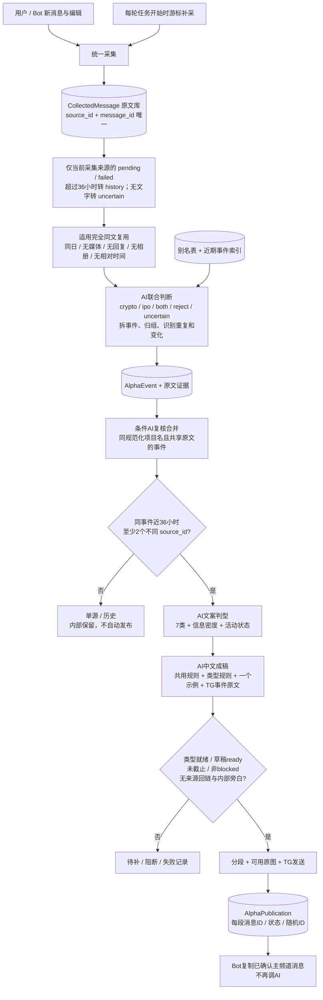

# P19｜当前架构与 AI 版块扩展检查

核对日期：2026-11-25，北京时间。代码基线：`4c443cc`，即本次从服务器同步到本地与 GitHub 的生产代码快照。

本文件区分当前实现、现场配置和扩展建议。此次仅检查与整理文档，没有修改业务代码、生产开关或发送消息。后续架构核对优先读本文；P12 保留此前设计与实施记录。

## 1. 结论与现场状态

目前是一个 Python 主进程持有 Telegram 用户与机器人客户端，另以 spawn 启动 FastAPI 子进程；React 提供管理页面。业务上保留三条链路：实时直转、旧聚合总结、Alpha 机会处理。AI 新版块目前只有本地离线实验与方案，没有生产处理链。

现场只读数据库查询结果：

| 项目 | 当前状态 |
|---|---|
| 服务 | `telegram-forwarder.service` 为 active/running；只代表进程状态 |
| 规则 | 共 57 条，全部开启规则及独立采集，关闭直转、关闭旧总结 |
| 采集来源 | 57 个 active 来源；新 AI 分组的 45 个来源尚不是一条独立生产流水线 |
| Alpha 任务 | 定时及发布均启用；模型 `gpt-6.1-sol` |
| 定时 | 北京时间 07:00、13:00、19:00、22:00；30 秒检查槽位 |
| 主目标 | `2026`，配置目标 ID `-1003905915992` |
| 同步目标 | `@xueqiu2026`；复制主频道已发内容，不再调 AI |
| 最近一轮 | 11 月 25 日 19:00 槽位，19:00:17 开始；结果 `partial` |
| partial 的依据 | 补采错误 0、分析错误 0、草稿错误计数 2、主频道发送 1、发送错误 0、未知回执 0；草稿错误计数包含 blocked，不能直接解读为模型调用失败 |

这些计数是核对时的快照，不是长期保证。采集与任务使用数据库、环境变量配置；Git 代码一致不代表各环境业务配置完全一致。

## 2. 当前进程与业务架构

```mermaid
flowchart TB
    TG[Telegram 来源频道与群组]
    UI[React 管理网站]
    WEB[FastAPI 子进程\n规则 / 机会 / 原文 / 导出 / 日志]
    BRIDGE[主进程内部 HTTP 桥\n默认 127.0.0.1:8001]
    DB[(同一数据库)]
    subgraph MAIN[main.py 主进程]
        CLIENT[Telethon 用户客户端 + Bot 客户端]
        LISTEN[message_listener.py\n新消息 / 编辑消息]
        POLL[条件轮询兜底\n只扫描未进入 MessageBox 的启动来源]
        COLLECT[alpha.storage\n采集 / 编辑 / 游标补采]
        LEGACY[旧实时直转\n用户原样路径 / Bot过滤器链]
        SUMMARY[旧 SummaryScheduler]
        ALPHA[Alpha 定时 / 手动任务\nrun_pipeline]
        MIRROR[镜像任务\n每30秒检查已发记录]
    end
    TG --> CLIENT --> LISTEN
    CLIENT --> POLL --> LISTEN
    LISTEN --> COLLECT --> DB
    LISTEN --> LEGACY
    DB --> SUMMARY
    DB <--> ALPHA
    ALPHA --> CLIENT
    CLIENT --> PRIMARY[2026 主频道]
    DB --> MIRROR --> SECOND[@xueqiu2026]
    UI <--> WEB
    WEB <--> DB
    WEB --> BRIDGE --> ALPHA
    PROVIDER[ai/ 模型适配\nOpenAI / Grok 等] <--> ALPHA
    PROVIDER <--> SUMMARY
    PROVIDER <--> LEGACY
```

图中旧路径表示代码仍保留，不表示当前有任务发送：目前 57 条规则的 `enable_forward=false`、`is_summary=false`。FastAPI 操作通过桥接进入持有 TG 客户端的主进程，不另外登录一个 TG 会话。

`main.py` 仍调用 `start_message_poller`。其轮询间隔是每轮扫描后等待 15 秒，另有逐频道等待，并非所有来源固定每 15 秒扫描一次。P17 是“待执行”的历史关闭建议，不能据文件标题认定当前 Poller 已关闭。

## 3. 当前 Alpha 的实际处理顺序



需要明确的几处实际行为：

- **Alpha 当前没有关键词预筛。** `filters/keyword_filter.py` 属于旧实时直转过滤器链，没有被 `alpha.pipeline` 调用。不能把离线实验词表当成已启用的线上过滤。
- **不是每条信息固定只调一次 AI。** 当前有联合分析、门槛后文案判型、中文成稿三种常规调用，另有条件式事件合并调用；分析和判型按批，成稿按事件，均存在适用缓存。
- 联合分析默认每批 12 条代表消息；判型每批最多 12 个事件。原文数量、独立事件数量、API 请求数不是同一个计数。
- 完全同文复用有明确限制，不是任意跨频道相似文都复用。内容有图、回复、相册、相对时间时仍需分析。
- 36 小时按消息发布时间计算，跨任务槽位累计来源；采集本身不只保留 36 小时。
- `consolidate_events` 是补救误拆的有限合并，不是全库语义去重；同项目但无共享原文、别名未归一时，不一定触发这层复核。
- 当前 7 种文案类型为：活动教程、发行与申购、资格查询与领取、积分与分配、重要进展与提醒、全球 IPO、平台上线预告。
- 成稿事实来自保存的 TG 原文及实体链接。当前主流水线没有自动搜索 X、打开外链核验或对图片做 OCR；示例仅控制写法，不是事实来源。
- 发送前可取回一张适用原图；图片不等于已被 AI 阅读。综合帖跨项目时不随意拿图片做封面。
- `unknown` 发送结果先对照频道近期历史，不自动盲重发；主频道和镜像各自保存回执。

## 4. 模块与数据边界

| 职责 | 主要代码 | 数据 / 接口 |
|---|---|---|
| 主进程、TG登录、桥接、子进程启动 | `main.py` | `/alpha-run`、`/health`、`/trigger-summary` |
| 新消息、编辑及旧转发分流 | `message_listener.py` | 用户 / Bot 监听入口 |
| 采集、补采、编辑失效、来源统计 | `alpha/storage.py` | `collected_messages`、`alpha_collection_state` |
| 分析、同文复用、任务总编排 | `alpha/pipeline.py` | 原文分析字段、`alpha_events` |
| 有限事件合并 | `alpha/consolidate.py` | 同项目共享证据事件 |
| 主题与成稿基础 Prompt | `alpha/prompts.py` | 分析 / 合并 / 成稿版本 |
| 门槛后判型、7类规则与示例 | `alpha/editorial.py` | `content_type`、`editorial` |
| 公共文案检查 | `alpha/public_copy.py` | 内部处理说明检测；另有成稿来源检查 |
| 定时任务与排他锁 | `alpha/scheduler.py`、`alpha/pipeline.py` | `alpha_job`；PG advisory lock / SQLite文件锁 |
| 发布、图片、分段与回执 | `alpha/publish.py` | `alpha_publications` |
| 主频道同步 | `alpha/mirror.py` | 已发主消息ID → 目标消息ID |
| 模型路由与调用 | `ai/`、`alpha/model.py` | 模型配置、JSON输出校验、usage |
| 网站机会页面/API | `frontend/src/pages/AlphaPage.tsx`、`rss/app/routes/alpha.py` | `/api/alpha/status`、`config`、`run`、`export` |
| 旧实时直转 | `handlers/user_handler.py`、`filters/process.py` | `ForwardRule`、关键词/替换/AI/RSS等 |
| 旧聚合总结 | `scheduler/summary_scheduler.py` | `forwarded_messages`、`summary_history` |

当前所谓“统一原文库”在存储上去重，但采集入口、来源状态和分析字段仍明显带 Alpha 业务耦合，尚不是完全通用的多版块框架。

## 5. 更新前检查结果

### 必须在接入新 AI 版块时解决

1. **来源没有业务隔离。** `sync_sources` 将所有开启规则且 `enable_collect=true` 的来源纳入同一 active 集合；`analyze_pending` 直接读取该集合。不能仅给 AI 分组打开采集，就认为它只会进入 AI 链。
2. **原文只有一套分析状态。** `CollectedMessage` 的 `analysis_status / analysis_version / analysis / usage / error` 当前由 Alpha 写入；AI 版块必须拥有独立处理记录，不可覆盖这些字段。
3. **任务与发布配置只有 Alpha 单例。** `AlphaJob(id=1)`、固定07/13/19/22调度和 `AlphaPublication(event_id,target_id)` 都是当前机会业务对象；AI 的目标、任务状态、规则版本和发布记录要独立。
4. **Alpha硬门槛不可复用成AI资格。** 36小时过滤、至少2来源、7种机会文案均有明确业务含义。AI版块取消这两个门槛，不能通过全局改常量来实现。

### 当前能力的限制与需要注意的点

- 采集保持原文一次入库，但实时、轮询和补采可能收到同一消息，由唯一键及内容版本处理；这不等于 TG API 只会读一次。
- 轮询的来源名单来自启动时的 `source_ids`，不是 AI 分组的自动动态订阅。新分组来源如何纳入生产必须显式接通。
- `candidate_context` 的历史全文展开仍依赖项目名/别名或相同URL；小型事件索引会提供给AI，但无词面命中的旧事件缺少全文上下文，存在漏归组边界。
- 一源事件不会自动生成公开稿；有活动但事实不足时会阻断。不能为凑每日数量放宽现有 Alpha 标准。
- 原文编辑会使证据和草稿失效；但已经 `sent` 的发布记录会直接跳过，不会自动撤回或编辑历史 TG 帖子。稿件失效与已发帖修订是两个能力。
- 新AI线没有正式网站入口、调度器或TG/X发送链。现有项目只有TG发布，不能把“文案可发X”表述成已支持X自动发布。
- 旧总结代码仍可由旧入口手动触发，执行时对 Alpha 主目标另有阻断；当前无 `is_summary=true` 的规则。此次不重新启用或清理它。
- 文档存在历史状态及编号冲突：服务器旧P13是轮询方案，本地新P13是AI筛选方案。阅读以标题和日期区分，后续统一整理；此次不重编号用户已确认文档。

## 6. AI 版块应如何接入（建议，尚未实现）

原则：共用 TG 连接、原文、模型适配和发送基础能力；来源归属、处理状态、分类、调度、选稿及回执分开。先完成独立 AI 最小链路，不把全项目重写成插件框架。

```mermaid
flowchart TD
    TG[同一套Telegram客户端] --> COL[共同采集与游标补采\n采集来源取两条业务订阅的并集]
    COL --> RAW[(同一原文库\n正文 / 链接 / 媒体 / 编辑版本)]
    AM[Alpha来源归属] --> AS[Alpha待处理集合]
    RAW --> AS
    AS --> ALPHA[既有Alpha链\n36h / 至少2源 / 7类文案]
    ALPHA --> AT[2026 + 镜像频道]
    IM[AI来源归属] -.-> IS[AI独立待处理集合]
    RAW -.-> IS
    IS -.-> KW[AI专用组合关键词宽召回\n记录排除与待判原因]
    KW -.-> REUSE[适用同文结果复用]
    REUSE -.-> CLASSIFY[AI按六子类 + U判断\n明确权益 / 方法 / 缺口]
    CLASSIFY -.-> GROUP[同一事项合并\n不同技术条件 / 方案保留差异]
    GROUP -.-> SELECT[真实时效 / 已发记录 / 内容价值\n无双源门槛 / 无36h资格门槛]
    SELECT -.-> COPY[AI专用中文文案\n基于TG事实保留可操作信息]
    COPY -.-> REVIEW[网站候选 / 待补 / 排除 / 原文核对]
    REVIEW -.-> PUBLISH[AI独立发布配置和回执]
    PUBLISH -.-> TARGET[@wanshenmeAI\nX用途文案输出；自动发布另定]
```

实线为已有共享能力及Alpha链；虚线为本轮准备新增的AI链。

AI筛选口径沿用用户已确认方案：B1注册/申请赠API额度、B5身份/地区/渠道领取、B6登录/邀请/老用户新增权益、T1接入/环境配置、T5 Token/速度/额度优化、T7注册/订阅/资格/账单，以及 U 热门模型实质更新/额度重置。福利和方法不限定热门品牌；只有 U 限定 Claude、GPT/ChatGPT/Codex、Grok、Gemini 等已确认范围。

7D 是首次历史重筛范围，日常从未处理消息增量执行；取消36h不等于发布已失效活动。每天1–3条是用户期望的内容产出，不能当作无条件保证或自动降低质量门槛。具体AI日常任务时刻尚需在实施时明确，不能直接冒用Alpha时刻为已确认配置。

最小改动顺序：

1. 增加业务来源归属，采集取并集，Alpha仍只处理原有来源范围。
2. 保留现有原文分析字段给Alpha，新增AI专用处理记录；同条原文可分别处理而不互相改状态。
3. 接入AI已确认词表、分类提示词、事项归组及候选/待补/排除状态，先支持手动运行和核对。
4. 接通AI独立文案、页面、发布记录和调度配置，再验证原文→筛选→成稿→目标频道整条路径；保持Alpha回归。

## 7. 核查依据与验证范围

- 静态检查已覆盖：主程序与监听入口、采集/补采/编辑、分析复用、事件合并、判型与提示词、发布与镜像、模型路由、数据库模型、Web API和旧总结边界。
- 现场仅做只读查询：当前规则开关、采集状态、Alpha配置、最近运行结果、发布状态及相关业务表。
- 刚完成服务器基线同步时，159个选定文件与服务器逐一校验一致；已有Alpha 52项与连接检查4项通过，前端构建通过。此次没有业务代码变化，复用该同版本检查结果，没有为架构整理重复调模型或发测试消息。
- 未做新一轮自然定时观察、真实外部API调用、浏览器交互或发送测试；因此本文不作“全部业务无错误”的保证。

核心代码入口：`main.py:368`、`message_listener.py:81`、`alpha/storage.py:44`、`alpha/pipeline.py:207`、`alpha/pipeline.py:368`、`alpha/editorial.py:84`、`alpha/publish.py:44`、`models/models.py:104`。

## 8. 2026-11-25 定时增量更新

用户确认新增北京时间22:00，Alpha每日执行时刻变为07:00、13:00、19:00、22:00。此次只增加调度时刻并同步网页说明，36小时、双来源、资格查询与Mint阶段漏斗均保持现状。部署晚于当天22点时不因新增槽位立即补发，后续时刻照常执行。
