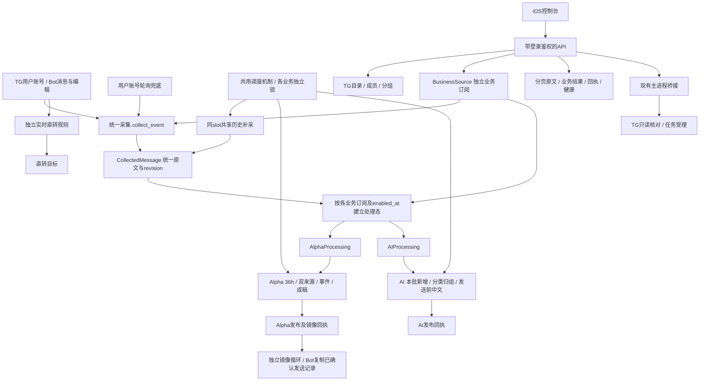

# P20｜iOS 平铺控制台：前后端与链路改造方案

日期：2026-11-26。状态：本地代码已实施并做隔离验证；复核发现5类未闭环问题，尚未完整验收，未提交、未推送、未部署。本文包含本次改造的唯一执行清单。

2026-11-26二次复核：已重新对照前端types/api/各页面、后端路由、模型、监听、补采、任务与发送代码；修正了原文计数口径，补齐配置局部更新、发布快照、日志来源、时间/身份字段及现有功能保留清单。以下为实施契约；当前本地实现状态见§9，生产仍为改造前基线。

## 1. 交付目标与范围

以 [iOS TG管理平铺版](../../output/frontend-preview-20261126/iOS-TG管理-平铺版.html) 为视觉和交互基准，把控制台改成能直接管理真实运行链路的工作台。首页为 TG 管理，频道、分组、业务订阅、采集、原文、直转在一张表上查看和操作。

用户已授权严格按本文执行代码更新；允许修改方案内代码并清理被替换的冗余文件。部署仍需另行授权。本地已实现页面、API、兼容迁移、主进程联动、旧入口收敛和约定清理。

依据：[P19 当前架构](P19-当前架构与AI版块扩展检查-20261125.md)、[P19 执行清单](P19-代码更新执行清单-20261126.md)及本轮代码、生产只读核查。原型里的数量、状态、频道和按钮结果均为演示，不作为生产数据或接口契约。

不改变：Alpha 筛选、36h 双来源门槛、AI 分类规则、AI 增量边界、失败不自动积压重跑、中文生成策略、模型值、发布目标、镜像、默认时间、发送及去重策略。不恢复旧聚合，不增加业务插件框架、批次历史平台或新 TG 会话。

## 2. 排查基线与结论

本轮核对基线：本地、GitHub、生产运行代码 `e41f7cf477f8df2592221249084426801674ac37`。生产目录 `/opt/TelegramForwarder`，服务 `telegram-forwarder.service`，PostgreSQL `telegram_forwarder`，网站 `https://xiexiu.io/tg/`。实施前需重新确认版本与工作区差异。

2026-11-26只读快照：Chat目录63条，活跃Alpha来源57、AI来源44，44个AI来源均未进入Chat目录；统一原文5020条且持续增长；57条规则的直转开关均关闭。快照只是核对证据，不写死到前端。

| 位置 | 已确认问题或缺口 | 本次处理 |
|---|---|---|
| 默认首页/规则 | 默认规则页；启用规则绿点容易被理解成正在转发，实际直转为0 | TG管理首页；规则启用与实际可发送分开显示 |
| TG目录 | 仅列Chat，未包含AI来源，无完整加入状态、分组同步 | 建统一来源目录视图，补全映射及同步能力 |
| 业务订阅 | 规则页enable_collect实为Alpha订阅，存在旧写入口 | 订阅统一由BusinessSource管理，旧入口收敛 |
| 采集状态 | active被展示为“采集中”，不能证明实际收取正常 | 分开显示订阅、成员状态、采集检查、最近收到原文 |
| Alpha来源 | 使用共享采集active，未来重叠来源会误示本业务订阅状态 | 本业务读BusinessSource.active，采集读共享状态 |
| AI内容页 | 全量原文/实体/正文周期轮询，无分页，JSON和英文状态直出 | 服务端分页、摘要列表、按需详情、明确中文状态 |
| 发布结果 | item资格状态与publication发送状态独立，candidate也可能已发送 | 资格、任务、发布分别展示，不混写数据库状态 |
| 任务操作 | accepted显示“操作完成” | 显示已受理，读取真实running/最终结果 |
| 配置保存 | 启停可能夹带尚未保存的model | 每种操作仅提交对应字段，不附带其他草稿值 |
| 健康/日志 | 绿点写死；WS前端路径与部署前缀不一致；卸载可能重连 | 接health；统一路径，清timer和连接；WS复用登录鉴权 |
| 密码 | 前端调用/tg/rss/change_password，生产无对应路由 | 补接现有auth体系下的密码修改接口，不删除功能掩盖断链 |
| 开发代理 | 页面使用/tg/api，Vite代理仍为/api | 开发与生产采用相同外部路径并正确rewrite |
| 来源动态变更 | 启动来源集合与动态业务订阅集合混合，退出来源可能自动Join | 统一运行来源计算，已确认退出不自动重入，保留直转配置 |

本地实现及隔离浏览器/迁移验证状态见§9；生产TG全量分组同步、PG实迁及部署后闭环仍未执行。

## 3. 信息架构与页面

### 3.1 导航

一级导航：**TG管理 → Alpha机会 → AI内容 → 直转规则 → RSS管理 → AI沙盒 → 运维**。账号菜单保留改密、退出。旧“机会草稿”更名后仍要包含真实发布结果，不只展示草稿。

TG管理以平铺表格为主，不使用“左列表—右详情—多层Tab”的常态操作路径。iOS浅色背景、白色内容区、克制圆角、清晰分隔线；颜色必须配文字，不能只靠绿点表达业务状态。

### 3.2 TG管理表格

顶部：搜索、TG分组筛选、业务订阅筛选、成员/采集状态筛选、同步TG、显示列。表格固定名称列，其余列可横向滚动，小屏不隐藏关键开关。

| 列 | 展示和交互 |
|---|---|
| 频道/群组 | 名称、username、规范peer ID、类型；缺资料显示待核对 |
| TG分组 | 可多分组；与Alpha/AI业务订阅分开 |
| Alpha / AI | 独立开关；保存中禁重复点击，失败恢复原值并提示 |
| 采集状态 | 未订阅/已启用待收取/最近收取/有错误/成员不可用/未知等事实文字 |
| 最近消息 | 最新原文发布时间；另标本系统最近接收时间，禁止混用 |
| 原文数量 | 默认该来源全部已保存原文行数，按(source_id,message_id)唯一；明确“全历史”；点击行内展开分页原文 |
| 直转 | 实际开启规则数、停用/阻断原因；打开直转规则定位到该来源 |
| 操作 | 低频操作菜单；同步差异和有影响的移除才弹窗 |

原文展开显示正文、媒体标记、发布时间、接收时间、revision、业务处理状态及内部来源链接。搜索和计数使用同一过滤口径；业务数量不可相加当作独立原文总数。

“原文数”不按content_hash跨频道去重，也不代表TG全部历史消息数。仅有直转规则、未订阅任何业务的来源，目前不进入统一原文库；显示“未启用业务采集”及已有历史数量，不能为填满页面而自动采集。只存媒体标记与实体，不等于已存图片文件；本轮不增加下载、OCR或外链抓取。

同步只核对和更新本地目录，不提供隐含的退出TG、加入TG或批量开启业务。停用业务不删原文。目录移除明确区分订阅停用、隐藏目录、既有规则删除的影响；有业务或规则引用时不得用普通移除悄悄级联删除。

本轮不新增“隐藏目录”业务能力；需要隐藏时仅用现有筛选。保留现有解析绑定、改名和移除入口，移除须列明现有源规则删除影响，目标规则/活跃业务引用时阻止普通移除并指引先处理依赖，不能静默删除业务订阅。改名保存为本地展示名，TG真实标题另存，TG同步不得覆盖人工改名。

### 3.3 其他页面

- Alpha/AI：顶部各自任务开关、发布时间、最近批次、发布开关、目标；列表按资格/草稿/发布状态筛选，详情才加载原文、归组和回执。目标与镜像先展示现值，不扩展任意目标配置。
- 调度编辑：沿用后端各业务独立配置；默认北京时间07:00、13:00、19:00、22:00。不得保存模型时切定时、切开关时保存模型。
- 直转规则：只管理实时转发条件、目标和该路径自己的过滤/Prompt；明确这些不控制Alpha/AI。移除Alpha采集开关入口。
- RSS、沙盒：保留现有可用功能，采用共同样式；沙盒实验用“聚合原文”不是旧定时聚合，不误删。
- 运维：读取真实health、最近批次与日志；未接通显示未知或异常；不杜撰完整批次历史。

### 3.4 新增分组与业务预留

TG分组来自同步结果动态生成；同一频道可属于多个分组。新增分组自动出现在筛选中，不自动订阅。

业务列、筛选、导航由一个轻量业务描述列表生成，初始仅Alpha、AI，包含key、名称、可用能力。未来新增业务要接独立模型/处理器/任务及接口后注册，不能只插一个字符串就启动任务。复用现有React和组件，不新增通用插件平台。

## 4. 数据与字段权威来源

统一原文仍为CollectedMessage；AlphaProcessing、AIProcessing及各自事件、事项和Publication继续分开。目录补齐不迁移原文身份，不触发历史重分析。

| 信息 | 权威来源/必要补充 | 禁止混用 |
|---|---|---|
| 来源身份 | typed peer ID + peer_type；复用Chat并补目录字段及映射 | 不给basic group/user直接套频道-100规范化 |
| 名称/username | 目录区分TG真实标题、username与本地展示名；BusinessSource展示统一取目录 | TG同步不覆盖人工改名；历史原文source_name保留采集时快照 |
| TG成员状态 | 用户账号joined/left/unknown + verified_at；Bot可访问性单独表达 | 用户退出不等于Bot退出；无法resolve、网络失败不等于退出 |
| TG分组 | 分组元数据及source-folder多对多关系 | 不能把业务标签当TG分组 |
| 业务开关 | BusinessSource(business,source_id).active | 不能用共享采集active代替单业务active |
| 共享采集启用 | 活跃业务来源的并集 | 停Alpha时不能停仍订阅AI的共享采集 |
| 补采检查 | AlphaCollectionState.scanned_at/error | scanned_at不冒充实时收到消息时间 |
| 消息发布时间 | CollectedMessage既有发布时间 | 不作为本系统成功收取时间 |
| 接收时间 | 原文新增received_at为首次入库；来源last_collected_at取其最大值 | 编辑/重复补采不重置首次入库时间，旧数据无值显示未知 |
| 发布结果 | 对应业务Publication和delivery回执 | 不从候选资格推断是否已发送 |

目录方案复用Chat：保留既有主键与外键，增加typed peer映射/核对元数据；先归一现有Chat与BusinessSource再补缺失目录，重复身份进入人工核对，不盲目按名字合并。不重写CollectedMessage.source_id和历史回执。

目录首次补齐复用BusinessMigration记录`source-catalog-v1`，一次性导入历史订阅身份；此后读取仅补活跃来源，已停订且主动移除的目录不会因刷新重建。显式TG同步或解析绑定可将仍存在的TG来源重新加入目录，不自动恢复业务订阅。不新增隐藏目录能力，不删历史业务数据。

目录还包含只作发送目标的Chat，返回来源/目标/两者角色，不能把全部目录当作订阅来源。各peer的可用能力显式返回：现有支持的频道/群组按对应类型处理，私聊用户等未支持的业务采集显示不适用，不为目录完整性扩展私聊采集。历史已有name先保留为展示名，首次同步不能擅自判断为“非人工改名”后覆盖。内部source_url只在能构成有效链接时返回；无username的basic group等不能套频道t.me/c公式生成假链接。

TG folder需要处理显式包含、排除及规则型分组；仅列显式peer会漏掉动态规则成员。返回解析完整性；未支持规则标待核对，不能伪称已完整同步。

BusinessSource取消/重启沿用现有enabled_at行为；编辑旧消息沿用当前AI增量边界，不借UI改造增加积压重试。迁移可加字段/关系，不能丢失原文、草稿、回执或用户配置。

## 5. 目标运行链路

TG同步通过现有主进程桥接使用已登录客户端；Web进程不新建session。与任务同slot的recover_history仍共享一次补采，不因多页面轮询重复补采。

### 5.1 同步与来源开关闭环

1. 点击同步：读取TG实际dialogs与分组，生成新增/改名/退出/未知差异预览，标核对完整性。
2. 确认应用差异：提交具体差异标识，应用前检查当前订阅状态，避免覆盖预览后的用户操作。失败或不完整扫描不能推断缺失来源已退出。
3. 对确认退出的来源，明确列出受影响业务订阅并确认停用；保留原文、结果、直转规则配置。直转运行时标成员不可用，阻止自动Join把已退出频道加回。
4. 行内启停独立更新BusinessSource，读取保存后的事实；主进程动态刷新有效来源，不能继续沿用启动时冻结集合。
5. 运行来源计算同时包含有效业务订阅和真实直转需要；停一项业务不误停另一个业务或直转。配置存在不等于有权自动重新加入已退出来源。
6. 若来源变更使同slot补采缓存过期，仅对必要缓存失效；新增来源实际接收和补采都需验证，不能只证明DB开关变了。

“确认退出”应在启动注册、实时入站、轮询和历史补采使用一致的成员/停订结果，不能只拦Join而仍在补采该来源。Bot是否仍可读单独显示；本方案不把用户成员状态冒充Bot权限检查。EXCLUDED_SOURCES及明确退出的Korean Alpha保持排除，目录同步不得复活其订阅。

### 5.2 任务与发布闭环

手动执行保持现有任务入口与锁；受理后显示运行中和实际结果，重复点击不启动第二份同业务任务。读取最近任务状态即可，本轮不新建完整历史平台。

AI仍在批次外部处理前推进analysis_until，仅处理本轮(lower, now]新增pending；不扫描此前failed/积压。界面可查看失败，不新增手动重跑/自动补发入口。

Alpha沿用用户客户端发布，镜像沿用Bot复制；AI沿用Bot发布和现有未知发送核对。前端保存发布开关时，后端只能修改明确授权字段；只读查看、同步、展开原文均不能调用AI或发TG。

## 6. API契约与页面覆盖

外部统一 `/tg/api/...`，后端内部 `/api/...`；Nginx和Vite均按此前缀映射。外部WS为 `/tg/api/ws/logs`。所有新增HTTP及WS入口复用既有登录鉴权，未登录不得读原文、日志或改配置。

以下为目标契约，接口名实施时以现有路由复用为先，但字段语义不能省略：

| 能力 | 契约与约束 |
|---|---|
| 来源分页 | GET /sources：q、folder、business、member_state、page、page_size；返回items/total/过滤范围/业务描述 |
| 来源行 | 稳定ID、peer类型、名称、folders[]、members状态、subscriptions、collection、latest消息、raw_count、direct规则摘要 |
| 订阅修改 | PUT /sources/{id}/subscriptions/{business}：仅active；校验已注册业务；响应保存后的订阅与共享采集状态 |
| 同步预览/应用 | POST /sources/sync/preview、/apply；应用具体差异，带完整性和预览标识；不顺带加入/退出TG |
| 原文分页 | GET /collected-messages：source/business/状态/关键词/时间/page；总数与列表同过滤；详情按ID读取 |
| 业务列表 | 两业务各自分页API，摘要不带全部原文；详情加载证据、草稿、媒体、Publication、delivery |
| 业务配置 | 复用alpha/ai-digest配置API；明确支持字段，局部patch；发布目标先只读 |
| 任务执行 | 复用run API；accepted与运行/最终状态分离；显示所属业务及时间边界，不返回假完成 |
| 健康与日志 | 复用GET /health及WS日志，真实错误可见，断开后清理重连timer |
| 账号改密 | 在/api/auth下补JSON接口；当前密码、新密码、确认；复用现有校验/哈希，不改登录架构 |
| 直转/RSS/沙盒 | 复用现有路由；页面搬迁后逐项验证现有增删改查和实验入口 |

API与TypeScript建立同名明确类型，移除受影响页面any/未解释JSON。HTTP成功但业务失败仍要显示失败原因；分页结果需要区分加载、空结果、错误，不能用空表掩盖异常。

### 6.1 现有契约与必须补齐的差异

| 实际代码入口 | 当前输入/输出 | 实施要求 |
|---|---|---|
| GET /chats、PUT /chats/{id} | Chat.id为本地整数，telegram_chat_id为字符串；name允许数据库NULL；返回源/目标规则数 | 新目录保留chat_id以关联规则，peer_id另列；name可空有显示回退，不把本地ID当TG ID |
| POST /chats/resolve | link输入，经主进程/resolve解析并绑定；目前桥接含频道专用握手 | 保留解析绑定；按peer_type决定握手，群组/用户不调用频道专用请求，不隐含业务订阅 |
| GET /alpha/status | counts、sources、events及任务配置；无Publication列表，无times；source来自共享采集态 | 拆摘要/分页详情，补独立业务订阅及发布读取，不假设已有回执API |
| PUT /alpha/config | enabled/model必填，schedule_hours可选；不接受publish_enabled | 必须同时改后端请求模型与赋值逻辑才能独立保存；补发布开关，目标保持只读 |
| GET /ai-digest/status | sources/messages/items/publications全量；message日期字段date，事项正文output_zh，Publication无独立id | 迁移为统一列表字段及按需详情；保留旧字段适配直到调用全部迁出 |
| PUT /ai-digest/config | enabled/model/publish_enabled必填，target_id缺省会取固定目标 | 改成仅更新显式提交字段；省略不得写默认值；保留固定目标约束 |
| PUT /ai-digest/sources | source_id/name/active；source_id走频道规范化 | 收敛到统一订阅写服务，typed peer映射后再写；不能保留另一套命名和开关写逻辑 |
| 两业务POST /run | 桥接异步accepted，已运行可能409；内存任务集合加业务RunLock | run不得先保存模型；受理与真正开始分开，根据last_run及任务状态确认；409显示正在运行 |
| 两业务GET /export | Alpha公开/内部Markdown，AI核对JSON | 保留格式、权限与公开/内部边界，不因分页只导出当前页；导出无AI/发送副作用 |
| GET /health | status、database.status/error、bridge.status及两客户端connected | 按真实字段映射；当前health是公开探针，不能声称它已有登录校验；新私有数据接口必须鉴权 |

配置局部更新使用显式提交字段集合（如Pydantic exclude_unset），并校验更新后的完整配置。enabled/model/publish_enabled缺省均表示不变，不能用None或False回填。只有真正重新启用定时、或时刻集合发生变化时，才沿用既有last_slot处理；保存模型/发布开关、重复保存相同时刻不得重置last_slot造成漏跑。停发布不等于停采集或停分析。

### 6.2 新读模型必须固定的字段口径

- 分页统一items/total/page/page_size；来源默认固定身份顺序，原文按published_at降序、id降序保证同时间稳定翻页；业务列表维持现有先后顺序，只加稳定ID兜底，不顺带调整业务排序。
- 来源返回chat_id:number与peer_id:string，message详情返回id:number（原文库ID）、message_id:number（TG消息ID）、source_id:string。TG peer ID、random_id均保持字符串，不用JS数字或名称做来源关联键。
- 原文统一published_at/edited_at/received_at、body/entities/media/grouped_id/source_url/revision；business_states分别含alpha.analysis_status与ai.status/recall/error，未订阅/未建立处理态为null，不虚构pending。查询处理状态必须同时指定business，避免同名状态混义。
- 时间API统一带UTC时区的ISO8601或null；前端统一按Asia/Shanghai显示，不继续对已有时区字符串盲加Z。日期过滤以同一时区换算UTC，起止边界明确；当前数据库naive UTC只在接口序列化处规范化，不重写历史时间。
- Alpha事件保留tier、content_type/type_status、draft_status/source_count/error；AI事项保留category/conditions/status/deadline/output_zh/error。任务状态idle/running/success/partial/failed独立展示；类别名读取既有七类Alpha和B1/B5/B6/T1/T5/T7/U定义，不在UI再建另一套分类标准。
- Publication详情含id、event_id或item_id、target_id、draft_hash、status、parts、created_at、error；parts按实际text/entities/photo/message_id/status展示，区分queued/sending/sent/failed/unknown。random_id不当消息ID展示；unknown只能显示待核对，不能标失败重发。
- 当前稿件可能因编辑或36h过窗失效，不能用当前draft/output_zh替代“已发送正文”。已发内容必须从Publication.parts读取，主频道与镜像按target_id分开；当前稿为空也要保留已发记录可见。AlphaPublication不含完整sources快照，旧记录不臆造当时证据，只展示现有可追溯信息与缺失说明。
- 原文total按原文行唯一统计；关联多个业务或多个Publication不能重复计数。来源行raw_count固定全历史，展开原文加筛选后另显示filtered_total，不把两者混称。计数在数据库聚合，不能每来源逐条全表加载。

### 6.3 日志、慢同步与功能保留

当前utils/log_config.py只设置StreamHandler，console.log_generator却猜测temp/forwarder.log或logs/forwarder.log，不存在时还创建空文件。必须先确认生产真实日志落点，再接现有日志源；日志源不可用明确报错，不创建空日志伪装接通。本轮不引入新日志平台。日志HTTP/WS错误、重连与鉴权按实际运行入口联调。

全量TG同步可能超过既有桥接10秒超时；需要核对一次真实耗时，复用可等待的后台受理/进度方式或合理超时完成预览，不另建历史任务系统。页面超时不能导致后台重复发起全量扫描；同步只有TG查询，无模型或发送操作。

除页面主线外，保留直转的关键词/正则、替换、媒体类型、推送渠道、规则同步，RSS自定义模式/正则测试，沙盒导入/历史样本/聚合原文/试跑/频道分析，以及原有下载入口。它们与业务订阅分别归属，不能因重排导航漏掉。沙盒试跑/频道分析本来会调用AI，需保留显式执行语义，不能混入“查看零调用”。直转配置中only_rss/enable_only_push等模式会影响真实发送，页面不得仅凭enable_rule和enable_forward承诺已在TG发送。

健康状态、无新消息、发布关闭、资格不合格、未到定时、任务失败、发送失败分别呈现，不以“没有推送”统一报故障。错误日志避免输出凭据和完整私有配置。

## 7. 模块实施边界

| 模块 | 预计涉及 | 允许改动 |
|---|---|---|
| 页面与类型 | frontend/src/App.tsx、App.css、api.ts、types.ts、pages/* | iOS样式、平铺交互、分页、真实状态、独立保存 |
| 目录与接口 | models、rss/app/routes/console.py及必要来源路由 | 目录/分组映射、统计、同步、鉴权、改密接线 |
| 业务接口 | rss/app/routes/alpha.py、ai_digest.py | 读模型/分页/配置字段，不改筛选和生成逻辑 |
| 采集联动 | collection.py、main.py、scheduler/chat_updater.py、现有桥接 | 同步主进程执行、来源动态生效、防已退出来源被自动重入 |
| 日志接线 | utils/log_config.py、console日志读取、实际部署日志源 | 接真实日志，错误可见，不建设新日志平台 |
| 配置与构建 | frontend/vite.config.ts、index.html、package*.json | 路径、标题、引用和确认无用依赖清理 |
| 旧入口 | Bot规则复制等使用enable_collect的调用点 | 去除隐含Alpha订阅写入，保持直转原有配置行为 |

实施前再次定位真实调用方；上述为范围边界，不代表可以无差别重写所有文件。独立发现的业务算法、JWT策略等问题只记录，不顺手改。

## 8. 旧文件与冗余清理矩阵

清理在新路径接通后同次实施收尾。先查静态引用、动态注册、脚本入口和构建产物，再删除；保留用户未提交成果。不能按文件名包含old/summary就删。

| 对象 | 处理与退出条件 |
|---|---|
| 旧TG页面内部层级和旧AI全量轮询 | 新平铺/分页替换后移除旧组件、状态、样式和调用，不保留两套隐藏实现 |
| 规则页enable_collect及Bot复制隐含写入口 | 收敛至BusinessSource；排查console、callbacks和测试，停止双写；兼容读若保留需注明用途 |
| ForwardRule.enable_collect数据库列 | 暂保留供首次迁移/历史兼容；不在本轮drop列，不当业务权威 |
| models/p19_migration.py历史旧字段 | 保留迁移与必要回滚兼容，不当运行垃圾删除 |
| rss/app/__init__.py中的另一个app实例 | 核查导入和启动引用后删除未使用实例，保留包文件；真实入口rss.main.app保留 |
| main.py中表面未使用的rss导入 | 查路由注册副作用后再决定，不能仅靠lint删除 |
| scheduler/chat_updater.py | 名称刷新职责由新同步接管或复用后才替换，不丢每日维护能力 |
| hero.png、react.svg、vite.svg、icons.svg等资源 | 按源码及index.html引用确认后删；favicon当前被引用，不直接删 |
| Monaco/Recharts/未用Radix等依赖 | 全仓确认无导入/动态使用后移除，更新lock并构建；真实Dialog/Switch等不误删 |
| 旧代理及“保留Jinja”失真注释 | 删除失效代理/注释，RSS实际feed和仍在用路由保留；当前无整套旧Jinja模板可删 |
| frontend/dist | 从源码构建并替换产物，不手改生成文件；服务器移除不再引用的旧hash资源 |
| output中的历版预览、scratch、temp | 不进入生产发布包；已有实验/手筛/用户材料本轮保留，不批量当垃圾删除 |
| 旧聚合名称 | P19已移除运行链路，不重建；沙盒聚合原文保留 |

迁移备份放生产备份目录，不混入Web静态目录。构建后检查引用不存在的资源、断开的导航/接口及残留已替换组件，清理应与替换一起交付。

## 9. 唯一执行清单

以下为唯一实施清单，共40项。勾选只表示该项在注明环境通过。已于2026-11-26获授权推送GitHub并部署服务器；当前38项通过，P02缺登录后线上浏览器核对，P03待下一自然时点观察，不以进程健康代替业务整轮。

执行纪律：严格按P20 §1范围实施，不改Alpha/AI业务标准、Prompt、模型值、目标、默认时间和重试口径。确需改变范围外行为时，说明具体原因、影响和最小建议，取得用户授权后再执行。每项通过才勾选；失败或受阻在该项后写明原因，状态仅用通过/失败/未执行/受阻。开发检查与部署后验证分别记录，不互相代替。

### 9.1 基线与字段契约

- [x] C01 核对本地、GitHub、服务器实际版本和未提交差异；标清本次文件范围，保留用户及其他协作者成果。 **通过：本轮只读核对三端同为e41f7cf；保留既有文档和未跟踪实验材料。**
- [x] C02 按§6.1–§6.2逐字段落实前后端类型及API输入/输出：ID、nullable、枚举、日期、分页、错误、任务受理与最终结果；区分已有能力和待新增能力。 **通过：补齐Alpha type_status/detail_level、AI条件/截止及Publication entities契约；隔离API与浏览器核对。**
- [x] C03 明确数据库迁移顺序、旧版本兼容及回滚办法；部署前生成必要数据库/配置/dist备份，禁止覆盖部署后的有效新数据。 **通过：已备份生产PG数据库、配置、代码与dist；pg_restore --list校验成功，新增字段迁移前后原业务行数和任务配置一致。**

### 9.2 目录与数据库

- [x] D01 补齐Chat与BusinessSource的typed peer映射，保留原主键、外键及原文source_id；覆盖AI独有、Alpha独有、双方重叠和仅作目标的Chat。 **通过：目录补全与typed peer映射已实现，隔离数据覆盖独有/重叠身份。**
- [x] D02 落实TG真实标题、username、本地展示名、成员核对状态/时间、多分组关系和解析完整性；人工改名不被同步覆盖。 **通过：目录统一展示名权威，旧摘要/导出读取人工名；每日刷新支持仅username变化且不覆盖人工名。**
- [x] D03 增加首次入库received_at及来源最近收取时间口径；编辑/重复补采不重置，历史缺值显示未知。 **通过：新增received_at；编辑不重置，历史空值不填造。**
- [x] D04 隔离库验证迁移与兼容：不丢原文、处理态、草稿、回执及配置，不重分析历史，不重置enabled_at/analysis_until。 **通过：SQLite隔离迁移可重复，旧行和业务边界保留；生产PG实迁归P02。**

### 9.3 同步、订阅与主进程链路

- [x] L01 经现有主进程桥接读取dialogs/分组，完成差异预览和确认应用；完整、部分、失败扫描分别返回，超时不重复启动同步，不新建TG会话。 **通过：现有桥接的隔离端到端扫描/确认应用通过，新增username和分组逐项差异、空分组变化及旧预览409校验；真实TG扫描归P02。**
- [x] L02 统一Alpha/AI订阅写服务；停一业务不影响另一业务，返回真实共享采集状态；明确排除来源不得被同步复活。 **通过：独立订阅统一写服务，停Alpha后AI保留；排除/退出来源禁止启用。**
- [x] L03 接通来源动态刷新，覆盖启动注册、实时消息/编辑、轮询与历史补采；清除冻结来源集合造成的残留，验证新增来源实际生效。 **通过：effective_sources动态供主进程和轮询使用；实时/编辑/补采继续走统一采集。真实TG运行归P02。**
- [x] L04 确认退出后，应用停订及运行阻断结果，防止自动Join；保留直转配置、原文与回执，成员未知不得当作退出。 **通过：退出状态阻断采集与直转，移除启动自动Join，保留数据。**
- [x] L05 验证同slot共享补采及来源变化时必要缓存失效；订阅/启用时间仍控制处理态建立，直转独有来源不自动扩大入库。 **通过：同slot缓存增加订阅签名；来源改变失效，处理时间边界保持。**

### 9.4 后端接口与读取口径

- [x] A01 完成来源与原文分页/筛选/详情/统计，按(source_id,message_id)唯一计数；原文全历史数与筛选数明确区分，关联多业务不重复计数。 **通过：原文分页筛选及源消息行计数；双业务不重复计数。**
- [x] A02 完成Alpha/AI摘要、分页列表与详情；资格、草稿、任务、发布状态分开，字段与TypeScript契约一致。 **通过：Alpha判型状态/信息密度、AI参与条件及两业务截止字段已映射并在详情展示。**
- [x] A03 补齐Publication读取：已发正文取parts，保留格式/媒体标记及消息ID；主频道/镜像分开，旧证据缺失如实显示。 **通过：从Publication.parts保留正文、实体链接/格式、媒体标记和消息ID；历史缺实体明确提示。**
- [x] A04 配置改成显式字段局部更新；补齐Alpha发布开关；省略值不修改配置，相同时刻不重置last_slot；目标约束保持。 **通过：exclude_unset局部配置，省略不改值；相同时刻不重置last_slot。**
- [x] A05 手动run独立于模型保存，复用现有锁和任务入口；accepted/409/运行中/最终结果分别处理，不新增历史重跑或补发入口。 **通过：手动执行与模型保存分开，复用既有桥接和任务锁，不增加重跑入口。**
- [x] A06 接通改密JSON接口与现有密码校验/哈希；私有HTTP/WS复用登录鉴权；开发/生产/tg/api与WS路径一致。 **通过：改密复用真实哈希校验，HTTP/WS拒绝未登录，开发代理前缀一致。**
- [x] A07 核对生产实际日志落点并接线；不能靠创建空文件伪装日志正常，日志异常可见且不泄露凭据。 **通过：只读确认生产日志来自journal；接线journal桥接，缺失报错，不建空日志；生产读取归P02。**

### 9.5 iOS前端与功能保留

- [x] F01 完成iOS浅色壳与TG管理首页；按§3导航组织页面，新增分组/业务列动态展示且不自动订阅。 **通过：iOS浅色、TG首页、导航与业务列同源描述，分组动态读取。**
- [x] F02 完成TG平铺表、固定名称列、横滚、筛选、显示列、行内订阅开关、原文分页展开及同步差异确认。 **通过：桌面/390px浏览器验证平铺、横滚、固定列、独立停订、原文展开；同步失败有明确提示。**
- [x] F03 保留解析绑定、改名和移除入口；展示来源/目标角色及能力，移除明确依赖和影响，不静默级联删除。 **通过：首次历史目录导入后仅自动补活跃来源；停订移除后刷新及重开数据库不复活，原文与业务数据保留。**
- [x] F04 接通Alpha/AI配置、任务、列表、详情、发布回执及原有下载；时间统一按北京时间显示，不盲加Z，接口错误不伪装空列表。 **通过：业务详情补齐既定字段，保存的已发实体正文与当前稿分开；北京时间截止和链接在隔离浏览器核对。**
- [x] F05 保留直转规则、关键词/正则、替换、媒体类型、推送渠道、规则同步；移除业务订阅混入直转配置的交互。 **通过：直转高级配置保留，隔离浏览器验证规则创建与关键词落库。**
- [x] F06 保留RSS配置/自定义模式/正则测试，以及沙盒导入、样本、聚合原文、试跑、频道分析；AI操作只在显式执行时触发。 **通过：RSS与沙盒接口/页面保留，浏览器验证RSS创建、沙盒原文聚合；未运行AI试跑。**
- [x] F07 运维接真实health、最近批次和日志；清理切页/卸载后的WS及重连timer；账号改密、退出接通。 **通过：运维展示真实health分项、最近批次及日志；连接/timer卸载清理，退出已验证。**

### 9.6 旧入口与冗余清理

- [x] R01 收敛规则页、旧API及Bot复制等enable_collect写入口；消除隐含业务订阅修改，不改变直转既有功能。 **通过：规则API拒绝enable_collect写入，旧Bot复制路径原已排除，不重复改造。**
- [x] R02 新路径接通后移除旧TG层级、全量轮询和已替换组件/状态/样式/调用；避免保留两套实际实现。 **通过：替换旧TG层级和Alpha/AI全量页面，删除旧组件引用。**
- [x] R03 按§8逐项查引用后清理无用app实例、导入、资源、依赖和代理；接管名称刷新职责后才替换chat_updater，更新依赖锁文件。 **通过：清理未用app实例/导入/资源/依赖及代理；chat_updater保留每日维护并保护人工名称。**
- [x] R04 保留历史迁移与必要兼容列、沙盒聚合功能、用户原始材料及无关成果；不批量删除scratch/output/temp，发布包不夹带它们。 **通过：兼容迁移与用户原始材料保留，未批量删除scratch/output/temp。**
- [x] R05 从源码构建dist并核对资源引用；部署时替换产物，清理不再引用的旧hash资源，备份不放Web目录。 **通过：部署源码对应的已验收dist，线上JS/CSS哈希逐字节一致；Web目录仅保留当前hash，旧dist保存在Web目录外的回滚备份。**

### 9.7 完整验收与范围审查

- [x] V01 完成§10目录/身份/订阅/同步测试，覆盖重叠业务、群组/频道、退出/未知、分组解析失败、重复点击和重启后的状态一致。 **通过：22项P20测试覆盖身份/订阅/同步/迁移/缓存；关闭重开数据库确认停订持久化。真实TG重启现场归P02。**
- [x] V02 完成字段/分页/计数/日期/状态/已发快照核对；验证配置局部更新及任务锁，不增加AI调用、失败积压重试或TG测试发送。 **通过：22项P20测试覆盖新增缺陷及既有字段/计数/日期/配置/锁；UTF-16实体、隐藏链接与转义另做真实组件渲染核对，无真实AI或TG发送。**
- [x] V03 真实浏览器验收桌面与窄屏的TG管理→原文→业务详情→发布回执→运维完整路径，覆盖加载/空/错误/长文本/横滚/弹窗。 **通过：隔离桌面/390px浏览器完成完整读取路径，并补核username/分组差异确认、业务条件/判型/截止及复杂回执链接；移除持久化由隔离API及数据库重开验证。**
- [x] V04 完成登录/退出/改密及私有接口鉴权，核对§6.3全部保留入口；运行构建与直接受影响回归，不机械全项目重测。 **通过：真实隔离登录/退出与改密API正确/错误密码；鉴权、构建、P19 26项与Alpha 50项回归通过。AI试跑未执行。**
- [x] V05 审查实际diff逐项对应P20；撤回本次无关改动，保留他人成果；更新P19当前架构引用及本清单，记录真实剩余限制。 **通过：实际diff与新增文件按P20核对，更新P19引用及本清单；业务Prompt/分类/模型值/目标/默认定时/重试未改。**

### 9.8 部署与交付（2026-11-26已获用户授权）

- [x] P01 按§11核对当前版本、任务占用、单实例、备份、迁移兼容和回滚；协调前后端发布顺序，避免新页面接旧接口。 **通过：部署前核对旧版e41f7cf、工作区干净、两业务无运行任务；完成备份、兼容迁移与前后端一起发布，保留代码/dist回滚。**
- [ ] P02 部署后核验实际代码与前端hash、API/WS/RSS路径、数据库迁移；通过已登录页面核对真实目录、原文、业务结果及已有回执，不以200/health代替闭环。 **未执行：尚缺重新登录后的线上浏览器闭环。生产版本1183d2a、资源哈希、PG实迁、真实TG同步、现有生产数据/回执读取、HTTP/WS鉴权及日志已验证；受保护数据检查使用服务器临时ASGI进程，并非线上浏览器登录验证。**
- [ ] P03 下一实际定时时点观察两业务的现有执行链路；未到时标未执行，没有合格内容不强行要求发送，发现失败按原因处理。 **未执行：已部署；下一自然时点19:00尚未观察，不主动触发AI任务或测试发送。**
- [x] P04 收尾临时服务/文件，保留必要回滚材料；说明已实现、已验证、已部署和自然运行观察各自结果及未完成项，不留失效入口或双写链路。 **通过：本地/远端临时检查进程已结束，传输文件移入专用备份，无额外TG会话或任务；保留回滚材料，部署完成与未完成观察分开记录。**

本地验证记录：修复后`tests/test_p20.py` 22项、P19 26项、Alpha 50项通过；TypeScript/Vite构建、Python编译及diff格式检查通过。浏览器使用专用SQLite和模拟回执，绝不作为真实TG发送结果。没有新增AI调用、没有生产写入。真实TG全量扫描、PG实迁、生产日志和自然定时保留到P01–P03。

### 9.9 代码更新复核（2026-11-26）

结论：未发现筛选、Prompt、模型值、目标、默认定时、AI增量或重试规则的越界变更；但下列5类方案内问题未闭环，撤回相关“通过”勾选，修复并定向验证前不作完整完成结论。此次只审查和纠正清单，未修改产品代码、未部署。

1. **来源移除后自动重建**：`source_catalog.ensure_catalog`无条件遍历全部BusinessSource补目录，含已停订来源。隔离API实测DELETE返回200，随后GET /sources又出现同一来源。修复须在既有移除语义内解决，不擅自增加隐藏目录或删除业务数据。
2. **名称/资料权威不一致**：隔离实测Chat.name由OldName改为NewName后，BusinessSource.name仍为OldName；Alpha旧摘要及AI导出仍读后者。每日chat_updater仅标题变化时更新username，单独更换username会残留旧值。须统一展示读取权威，不改历史原文source_name。
3. **同步差异预览不完整**：main.sources_sync的previous/change只比较telegram_title、member_state；仅username/分组变化会标unchanged，TG页面过滤后不呈现对应变化，仅列新分组名称不构成归属差异确认。应用层仍会写分组，需补齐预览，不改变订阅/成员判断标准。
4. **业务详情契约/展示缺项**：Alpha统一API未独立映射editorial.status到type_status，前端ContentItem及详情未展示判型状态、AI conditions/deadline等既定字段；不能仅显示正文与回执就算完整字段闭环。
5. **已发正文隐藏链接/格式遗漏**：delivery.make_parts把Markdown链接和粗体转换成text+entities；当前前端只显示part.text且Publication.parts类型不含entities。实测“[官方网站](https://example.org/claim)”最终在回执页只剩“官方网站”，链接无法查看。需按保存的实体呈现，不能回用现稿冒充已发正文。

范围复核证据：相对基线e41f7cf，alpha/prompts.py、editorial.py、pipeline.py、publish.py、mirror.py、scheduler.py，ai_digest/pipeline.py、prompts.py，delivery.py和utils/settings.py均未变化。collection/main等采集相关差异属于P20明确允许的首次收取时间、动态来源、成员阻断和同slot缓存失效；删除项属于§8清理矩阵。复核时发现的名称导航差异已在本轮统一为Alpha机会/AI内容，未改变业务。

### 9.10 本轮修复与收尾（2026-11-26）

§9.9保留发现时的失败记录；本轮5类缺陷均已修复，9项撤回项已据验证恢复勾选。修复完成时40项中34项本地通过，6项部署/收尾未执行；后续用户已授权上线，最新部署事实见§9.11，不把历史状态当当前状态。

- 目录移除不再被停订历史记录重建；名称读取统一；username和分组变化有逐项预览及确认应用。
- 业务详情补齐判型、密度、条件和截止；已发parts按保存的entities渲染，隐藏链接、粗体及UTF-16偏移保留，旧缺值如实展示。
- 清理重复的同步比较/展示容器及无用导入，原有替换组件、资源和依赖清理保持§8范围；历史迁移、必要兼容字段、用户材料保留。
- P20 22项、Alpha 50项、P19 26项通过。P19首次回归有1项因模拟回执固定时间早于实际Publication.created_at失败，修正测试夹具为发送后时间后通过，未修改发送逻辑。
- 最终构建资源为`index-BCfbLh-F.js`、`index-DYb6eShA.css`；Python编译及diff格式核对通过。浏览器用真实构建/API、隔离SQLite与TG边界替身，不等同生产PG、真实TG查询或真实发送。
- 本轮隔离服务及浏览器页已关闭，8000/58006监听已释放，仅删除本轮两份预览fixture；保留测试日志与既有材料。未提交、未推送、未部署，无真实模型调用或TG发送。

### 9.11 GitHub与生产部署（2026-11-26）

用户明确授权“上传Github，然后部署到服务器”。运行代码提交`1183d2ab08033dc5aaf4bc0126adc5714a3f6da2`已推送`origin/main`并部署`/opt/TelegramForwarder`。本节随后的仅文档提交不改变运行代码或重启服务。

- 回滚目录：`/var/backups/tgbot-p20-20261126/release-1183d2a`，含数据库dump、旧代码归档、旧版本号、配置、旧dist及状态快照。数据库dump约2.3MB，pg_restore目录校验通过；无drop/清历史业务表。
- 停机窗口内完成新增字段/目录关系表迁移，前后collected_messages 5077、Alpha处理态4901、AI处理态176、Alpha事件695、AI事项10、Alpha回执115、AI回执9、业务来源102、用户1均保持。任务enabled/publish_enabled/model/target_id/last_slot/analysis_until等未改。
- 服务启动后主进程唯一，NRestarts=0；数据库、内部桥接及两个TG客户端健康。定时仍07/13/19/22，两业务原有partial状态保留，不伪造成功。
- 复用运行中的用户客户端真实扫描124个TG实体、2个分组，扫描完整、无错误、无活跃来源退出；应用目录资料后126个目录条目、2个分组，业务订阅无变化，不新建TG会话、不加入/退出TG。
- HTTPS首页与JS/CSS/favicon可读，资源哈希与本地已验收dist一致；旧hash从Web目录退出，保留在回滚目录。真实HTTP未登录sources返回401，真实WS未登录握手403，RSS不存在ID返回原有404；journal桥接可读取真实日志。
- 在服务器临时ASGI检查进程中，使用当前代码、生产PG及该进程签发的现有用户测试会话，核对目录/原文分页与详情、两业务状态/列表/详情、实际保存回执及导出，并经现有主进程桥接完成同步。测试会话只在该临时进程有效，未改变线上鉴权或账户密码；不宣称这是线上浏览器登录验证。
- 线上浏览器确认新版登录入口已加载；旧会话因服务重启失效，需用户使用现有网站账户重新登录后，补齐P02的可见页面核对。P03下一自然定时19:00未观察；部署检查未手动触发AI分析/生成任务或频道测试推送。
- 临时检查进程已退出，远端传输文件已移入回滚目录。未删除用户output/scratch资料或历史兼容代码。

## 10. 验收标准

先验证契约和迁移，再做浏览器联调；无需为UI改造反复调用模型或向频道试发内容。现有测试优先复用，新增仅覆盖真实变更和直接受影响路径。

1. **目录完整性**：覆盖Chat独有、Alpha独有、AI独有、双方重叠、群组/频道、已退出/未知、多分组；无同源重复行，无ID误转换。
2. **订阅闭环**：隔离环境中启停后刷新与重启均一致；取消Alpha不影响AI；新增来源实际可被主进程处理；失败回显旧值，重复点击不重复写入。
3. **同步安全**：完整/部分/失败扫描分开；预览后配置变化不被覆盖；确认退出不自动Join；目录动作不删原文/回执，不发TG。
4. **分页与统计**：列表、筛选、详情、数量在同一范围一致；资格与已发送并列正确；历史时间未知如实显示，不伪造健康；重复来源正文不合并原文行，重叠业务不重复计数；已有时区不重复加Z，修改后稿件不覆盖已发parts展示。
5. **任务与配置**：独立保存不夹带未保存字段；省略字段不改默认值，相同时刻不重置last_slot；受理不冒充完成；两业务时间仍07/13/19/22，AI边界与不回捞失败保持；查看数据零AI调用。
6. **账号与运维**：登录、退出、改密成功/错误密码均走通；未登录HTTP和WS拒绝；真实健康错误可见；切页/卸载无残留重连。
7. **原有功能**：按§6.3逐项核对保留入口，直转规则、RSS、沙盒代表性增改查和下载路径仍可用；不得把直转自有AI配置误接到业务过滤；手动执行不得先隐式保存模型；绑定/改名不因同步被覆盖。
8. **视觉与构建**：真实浏览器桌面/窄屏核对平铺操作、横滚固定列、展开行、弹窗、长中文、空/错/加载状态；构建和相关回归通过，实际加载当前hash，无旧资源404。
9. **范围和清理**：diff无筛选/Prompt/目标/模型/重试变更；旧入口与未引用实现确实退出；仍有用途的兼容代码列明，不以删除数量验收。

生产写入验证优先使用可恢复的专用测试来源，涉及真实发送需单独明确测试对象和授权。自然定时只在下一实际时点观察；若尚未到时标未执行，不把health通过等同整轮发送通过。

## 11. 部署与回滚

部署前核对Git版本、数据库迁移兼容、当前任务状态和单实例，备份必要表/配置/原静态产物；先验证迁移，再发布对应后端与前端，避免新页面接旧字段。

具体迁移复用现有 `scripts/migrate_p19.py --backup /var/backups/tgbot-p20/<本次新目录>/database.dump`，不加 `--finalize`。先停止应用，创建独立备份目录，备份原代码版本、配置和dist；使用服务相同环境（含DATABASE_URL）和venv执行。脚本先备份再init_db，P20仅新增目录字段/关系表与received_at，不删旧列，不修改游标。脚本成功后检查schema与业务行数再启服务。备份文件不得置于Web目录，禁止重复覆盖旧备份。

部署后验证 `/tg/`、`/tg/api/`、`/tg/api/ws/`、RSS原路径；检查真实加载的前端资源和代码版本，登录后跑目录—原文—业务结果—回执—运维闭环。仅监听端口或主页200不足以验收。

回滚保留上一版本代码与dist；本轮schema以可向后兼容新增为主。发现阻塞先关闭新UI入口或恢复上一版本，不drop业务表、不清原文、不重置批次边界。若需恢复数据库，必须核算部署后新收原文和回执，不能覆盖有效新数据。

实施后更新本文清单及P19当前架构引用；历史方案仍供追溯，不能与当前实现混称。未经新的授权，不把本方案自动转成生产操作。
